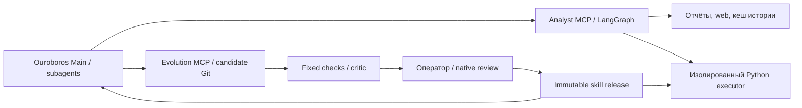

# Архитектура

Ouroboros координирует Main, discovery навыков, specialist subagents и native review. Analyst MCP предоставляет стабильные инструменты; LangGraph выполняет поиск и проверку ответа. Evolution MCP создаёт предложения, оператор выпускает их.

## Разделение

- **core Git**: MCP, данные, контракты, проверка цитат, backtest, evaluator и release controls.
- **evolution Git**: четыре `SKILL.md`; forecast/scenario в `oil_forecast`, chunking/reranking/query_strategy в `report_rag`, search_strategy в `web_research`; retrieval/source policies.
- **workspace**: единственное Files-хранилище Reports/Prices/Models, индексы, traces, диалоги и immutable bundles. В Git не входит.

Методы экспортируют `run(request)`, получают только разрешённые данные. Core восстанавливает метаданные по исходным индексам и проверяет результаты; методы не могут подставить произвольные ссылки. Python из evolution не импортируется в MCP.

Executor не имеет host mounts, Docker socket и модельных секретов. Trusted parent помещает каждый job в chroot, меняет UID/GID, устанавливает seccomp и resource limits. Один job выполняется, до четырёх ждут не более десяти секунд. Есть wall timeout, ограничение вывода и очистка потомков. Это не защита от уязвимостей ядра.

## Аналитика

Фактические вопросы: report-first через `answer_question`; достаточные отчётные данные основные, web используется для пробелов и свежести. Свежие новости, котировки и новые расчёты допускают прямые инструменты. Источник, дата публикации и время получения различаются.

По умолчанию HyDE + E5/Chroma/BM25. `query_strategy.py` задаёт prompt, поисковые запросы, веса эмбеддингов и слияние; поддерживается MultiQuery. Core вызывает отдельную Lite, кеширует генерации и исполняет ограниченный план. PDF чанки сохраняют report/date/page и offsets. Web ограничен списком доверенных доменов; используется DDGS и RSS EIA без платного поискового ключа. Claims проверяются по исходным цитатам/числам; это структурная, а не полная смысловая проверка.

ARIMA(1,1,0) и damped ETS работают на log месячной цены. Core передаёт исторические префиксы, отдельно калибрует и оценивает интервалы по горизонту, сравнивает с naive. Модель выбирается на calibration, не на test. Supply-cut — условная чувствительность по явным пользовательским эластичностям.

## Самоулучшение

Кандидат меняет policy, инструкции или один из шести фиксированных Python slots. Fixed paired checks требуют прироста без индивидуальных регрессий; тесты и эталоны остаются в core. RAG checks прогоняют весь retrieval-пайплайн с 13 записанными генерациями Lite: проверяют все нужные цитаты и средний reciprocal rank их позиций. Для chunking/reranking дополнительно сохраняются 19 прежних проверок. Изменённый prompt требует подходящих operator-owned записей; без них проверка недоступна, LLM автоматически не вызывается. Это не blind holdout. После PASS нужен critic; затем оператор stage, native restart/review и enable.

Инструкции и Python выпускаются одним snapshot. На переходе admission закрыт. Запрос закрепляет методы одной версии; chunking выбирает собственный индекс по хешу. Rollback восстанавливает skill files отдельным коммитом и переключает pointer. У разработчика остаётся право явного изменения baseline; это не считается доказанным самоулучшением.

## Компромиссы

TODO: создание из чата новых Python-модулей и MCP-инструментов через расширяемый каталог `evolution/tools/` в существующем MCP-сервере. Пакет содержит manifest со схемами входа/выхода и владельцем-скиллом, реализацию и инструкции. До активации нужны изолированное исполнение, проверка контрактов и качества, native review и подтверждение владельца; после — обновление discovery и атомарный откат. Доступ к сети, секретам и новым зависимостям требует отдельных разрешений. Это план развития, пока доступны только существующие Python slots.

Два frozen PDF ограничивают покрытие; нужен более широкий корпус и независимые кейсы. Номинальные интервалы не гарантируют 80% coverage. Lite выбран для экономии, сравнительной оценки моделей нет. Следующие приоритеты: качество retrieval, смысловая проверка ответов, проверка полного UI на чистой установке и публикация репозитория.

Авторизация модулей общая: protected registry связывает MCP/специалистов с навыками, а runtime проверяет enabled и актуальный native review перед исполнением. Неизвестный владелец запрещён. Gates стоят на MCP, внутренних методах и Python slots; инструкции модели не заменяют эти проверки. При публикации существующие переключатели сохраняются.
