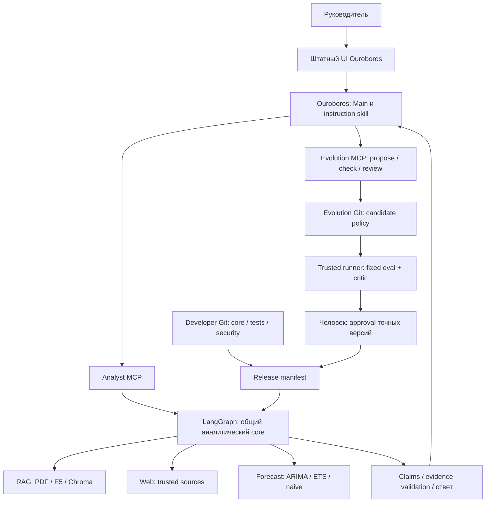
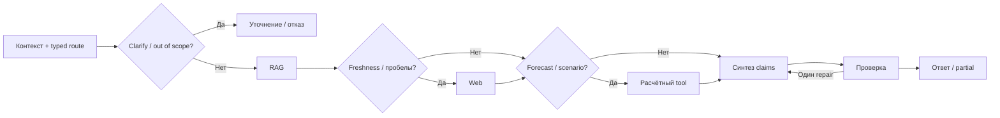

# AI-агент «Нефтегазовый аналитик»: архитектура недельного MVP

Обновлено: 2 ноября 2026. Статус: **функциональные пути реализованы; качество и внешние проверки имеют явно отмеченные ограничения**. Фактические проверки и незакрытые gates: [docs/INTEGRATION_STATUS.md](docs/INTEGRATION_STATUS.md).
Ограничение по строкам снято пользователем 1 ноября 2026. Приоритет — читаемость, полный функционал и проверяемые результаты. Актуальная реализация: README.md и docs/INTEGRATION_STATUS.md; таблицы раннего бюджета ниже сохранены как история планирования.
Исходный набросок: [сохранённая версия](docs/ARCHITECTURE.original.md). Обоснование изменений: [ревью](docs/ARCHITECTURE_REVIEW.md).

## 1. Цель и происхождение требований

Пользователь — руководитель, которому нужны краткий вывод, подтверждённые цифры, актуальность и понятные ограничения. Результат: аналитическая справка, сравнение источников либо расчётный прогноз. Основной критерий — проверяемость ответа и воспроизводимость работы.

| Статус | Требование / решение | Основание |
|---|---|---|
| Подтверждено заданием | Python 3.10+, LangChain/LangGraph, Ouroboros | DOCX: общее описание, §3 |
| Подтверждено заданием | RAG по PDF с названием/датой/страницей; web с фильтрацией СМИ; приоритет отчётов | DOCX §2.1–2.4 |
| Подтверждено заданием | Самостоятельный выбор forecast tool, два метода, интервалы, сценарные запросы | DOCX §2.5 |
| Подтверждено заданием | UI, Docker, .env, README, данные/загрузчик, 5 диалогов, краткий отчёт | DOCX §3–4 |
| Требование пользователя | Понятный код, желательно ≤3000 строк; неделя на работу | Сообщение пользователя |
| Предложение | Управляемое самоулучшение на воспроизводимых ошибках | Пользователь привёл его как пример инициативы; конкретный механизм в DOCX не задан |
| Предложение | LangGraph отвечает, Ouroboros использует MCP и создаёт улучшения | Предсказуемое выполнение и отдельный контур разработки |
| Предложение | Отдельные Developer/Evolution Git, проверенный manifest | Идея исходного плана, с сокращённой инфраструктурой |
| Допущение | Один оператор, публичные данные, локальный запуск, разрешённый LLM API | При иных условиях нужно пересмотреть размещение и доступ |
| Открыто | SHA Ouroboros, LLM/model ID, ключи, реальные данные и бюджет | Проверить в день 1 до основной реализации |

MVP прогнозирует **среднюю месячную Brent spot, USD/bbl**. WTI/Urals остаются в аналитической области; ограничения их количественного прогноза сообщаются явно. За рамками: торговля, приватные банковские документы, OCR, production SSO/RBAC, автономное развёртывание. Эти границы предложены нами, не установлены работодателем.

## 2. Архитектура и минимальность



| Компонент | Польза | Цена / более простая альтернатива |
|---|---|---|
| LangGraph StateGraph | Явные ветвления и один repair, решения модели ограничены контрактом | Обычные функции проще, framework требуется заданием |
| Один core для UI и MCP | Нет двух реализаций аналитики | Нужны проверки паритета входов; несколько аналитических агентов не нужны |
| Chroma + local multilingual-e5-small | Векторный поиск с metadata, RU/EN, локальная индексация | FAISS проще по storage, потребует своего слоя metadata |
| Один web adapter | Актуальные сведения | Собственный crawler не нужен |
| statsmodels | Два проверяемых метода | LSTM/Prophet не оправданы недельным объёмом |
| Ouroboros + instruction skill + MCP | Содержательное выполнение требования, автор улучшений | Отдельная настройка и живой smoke test |
| Evolution MCP + trusted runner | Ouroboros самостоятельно предлагает и проверяет кандидата | Узкий MCP adapter над проверками; без generic Git API и отдельной БД |

**Уточнение после обсуждения:** Evolution MCP сохраняется как отдельный интерфейс самоулучшения. Сокращаем универсальность backend, а не убираем агентный цикл: Ouroboros сам предлагает кандидата, запускает фиксированные checks, запрашивает critic и получает статус; человек требуется на выпуске. Исполняемые поверхности — retrieval-policy, инструкции навыков и Python в фиксированных method slots. Произвольные core-патчи не разрешены: методы работают через защищённый JSON ABI в отдельном executor; выпуск пакета требует оператора и native review. Две Git-истории, exact-hash review, manifest и rollback сохраняются.

Ouroboros участвует и в аналитике через MCP, и в авторстве улучшений. По согласованию используется штатный UI Ouroboros: Main вызывает `answer_question` через Analyst MCP, а тот исполняет общий core. Финальный пересказ Main пока может ошибиться в происхождении данных; это открытый gate, подробнее [UI.md](docs/UI.md). Без реального вызова из Ouroboros задание не считается полностью выполненным, даже если UI работает. Свободный planning loop для каждого ответа не нужен: агентность проявляется в выборе маршрута/tools и самостоятельном создании кандидата.

## 3. Технологии и структура инструкций

Предлагаемый stack: Python 3.11, LangGraph/LangChain, Pydantic, PyMuPDF, Chroma, sentence-transformers/E5, statsmodels, штатный UI Ouroboros, MCP Python SDK, pytest/ruff. Совместимые версии закрепляются lock-файлом после совместного smoke test. LLM-клиент — тонкий LangChain adapter; совместимый API не гарантирует одинаковый structured output у любой модели.

Провайдер/model ID выбирается в день 1 по доступу, допустимости передачи публичных текстов, русскому языку, structured output и стоимости на контрольных запросах. README фиксирует фактический выбор. До проверки конкретная модель и её качество не объявляются выбранными.

Инструкции и материалы:

- Роль в `evolution/ouroboros_skills/oilgas_analyst/SKILL.md`, synthesis prompt в `src/analyst/graph.py`: роль старшего аналитика, Upstream/Midstream/Downstream, Brent/WTI/Urals, ОПЕК+, спрос/предложение, санкции; краткий вывод, источники, неопределённость.
- Route prompt в `src/analyst/graph.py`: typed intent, сущности, период, freshness, необходимость уточнения.
- Structured contracts/validator в `src/analyst/contracts.py` и `evidence.py`: claims только из evidence/расчётов, факт отдельно от допущения.
- `policies/`: декларативные стратегии retrieval, без исполняемого кода и команд.
- `ouroboros_skills/oilgas_analyst/SKILL.md`: instruction skill с методом работы через Analyst MCP; штатный lifecycle установки/review/enable.
- `evals/`: случаи, rubric и эталоны вне прав автора кандидата. PDF/web передаются отдельно как недоверенные данные.

Платформенный gate дня 1: полный SHA Ouroboros, запуск, HTTP transport MCP, живой tool call, manifest skill и фактический допуск skill. MCP и lifecycle подтверждаются upstream; конкретные настройки из исходного плана требуют проверки по pin. В текущем configuration guide отмечены **inert review env keys** — старые env-примеры не копировать без проверки settings/API/source. Ревью внешнего проекта не подразумевается из ревью ядра Ouroboros.

«Штатный skill» не означает ownership bucket `native`: custom skill устанавливается через поддерживаемый external/source bucket. Настройки LLM/Ouroboros не заменяют OS/container isolation. Сам runtime Ouroboros в MVP не обновляется автоматически.

## 4. Поток запроса и память

State: `question`, `resolved_question`, `intent`, `entities`, `period`, `freshness_required`, `evidence[]`, `forecast`, `claims[]`, `warnings[]`, `status`, `budget`. Metadata: request/session IDs, release ID, model/corpus/data versions, usage/timings. Секретов в state нет.



LLM выбирает `domain_qa|forecast|scenario|out_of_scope|clarify` по Pydantic-схеме. Код проверяет параметры, права и бюджет. Явное «сейчас/сегодня/последние» требует freshness-пути независимо от уверенности модели. Для профильного вопроса сначала RAG; web нужен при актуальности/пробелах. Достаточность RAG определяется покрытием запрошенных сущностей/периода и supporting evidence; cosine similarity не является вероятностью истинности и не даёт универсального sufficient threshold.

Сессионная память реализована в SQLite: до 6 последних пользовательских вопросов и structured route/параметры, с TTL и сериализацией одной сессии. «А теперь на полгода?» наследует Brent из предыдущего запроса. Старый ответ модели не evidence: поиск и freshness проверяются заново. Неясное «а у них?» ведёт к уточнению. ID выдаёт сервер, сессии не смешиваются. Контекст сохраняется при рестарте; несовместимое обновление core сбрасывает сессию. Незавершённое вычисление автоматически не возобновляется. Release закреплён на сессию, новый bundle действует в новой.

Out-of-scope → краткое пояснение роли без tools. Ошибка источника → partial с пробелами. Ошибка синтеза после одного repair → шаблонный ответ из проверенных evidence/tool results. Уточнение возвращается пользователю без фонового исполнения неясного запроса.

## 5. Корпус, ingestion и retrieval

Минимум: по одному публичному OPEC MOMR и EIA STEO с пересекающимся периодом; публичный IEA summary/выдержка при доступности. Ограничение summary относительно полного платного отчёта указать. Загрузчик использует только URL из manifest. Snapshot фиксируется до оценки; изменение mutable URL не считается воспроизведением старого корпуса.

`data/manifest.json`: title, publisher, URL, publication date, retrieved_at, sha256, local path, language, material type, extraction status. Новый snapshot/index активируется целиком после проверки, не смешивается с прежним молча.

Ingestion: sha256 → PyMuPDF по страницам → чанки ~600 токенов с overlap ~100 → E5 `passage:` → Chroma; запросы — `query:`. Chunk ID: hash документа + PDF page + offset. PDF page и печатный номер могут различаться, хранить отдельно. Повторный ingest неизменённого snapshot идемпотентен.

Пустые/сканированные страницы получают warning и не используются как evidence. Табличные цифры MVP допускаются только из заранее проверенных страниц/строк с сохранёнными заголовками, периодом и единицами. Наличие числа в повреждённой таблице не доказывает его принадлежность нужной метрике. OCR и универсальный table parser отложены.

Retrieval: top-k=6 по умолчанию, hard cap 12; дедупликация, независимая выборка по издателям при сравнении. Различать **published_at** и **reference_period**: октябрьский отчёт может прогнозировать следующий год. Для «спрос в 2027» нельзя требовать published_at=2027. Если период показателя надёжно не извлечён, проверять текст evidence и сообщать неопределённость, не отбрасывать документ ложным metadata filter.

Сравнение нормализует metric, geography, unit, reference_period, publication vintage, actual/estimate/forecast. Арифметическая разница только для сопоставимых определений; несовпадения показать с пояснением. Эти ограничения находятся вне изменяемой policy.

## 6. Web, claims и финальный ответ

DDGS/DuckDuckGo и фиксированный официальный RSS EIA, без платного API-ключа. Приоритет: официальные агентства/регуляторы → проверенные новостные агентства. Allowlist parsed hostnames с точной границей поддомена; строковый `endswith("eia.gov")` без точки недостаточен. Неподтверждённые СМИ исключаются из доказательной базы. Доверенный домен не гарантирует поддержку конкретного тезиса.

Базовый MVP использует **snippets поискового API**, явно помечает их и не заявляет чтение полной статьи. Собственного arbitrary URL fetch нет. Если fetch станет необходим, до соединения проверять DNS/IP, каждый redirect, loopback/private/link-local/metadata, byte/time limits. Проверка конечного URL после загрузки не предотвращает SSRF.

Evidence: `id`, `kind=report|web`, `title`, `publisher`, `published_at|null`, `retrieved_at`, `reference_period|null`, `url`, `page|null`, `text`, `doc_hash|null`. retrieved_at не заменяет дату материала. Котировка требует instrument/price type/timestamp/unit; страница без надёжной даты не доказывает «сегодня». При отсутствии live feed текущая цена не выдумывается.

Синтез выдаёт claims: текст, `fact|calculation|assumption`, evidence IDs, exact supporting spans; у числовых фактов — value/unit/period. Расчёты содержат формулу/входы и tool run ID. Markdown и список источников формируются кодом из проверенной структуры, без генерации произвольных URL/страниц.

Deterministic verifier проверяет IDs/страницы, наличие spans, структуру числа/единиц/периода, простые вычисления и freshness. Он **не доказывает смысловую поддержку тезиса**: реальная цитата может быть нерелевантна. Faithfulness проверяется отдельно ручной rubric-разметкой контрольных случаев; LLM judge вспомогателен. Никакого обещания нулевых галлюцинаций для всех запросов.

Ответ: вывод в 1–3 предложениях → ключевые факты `[R1]`/`[W1]` → расчёт/сценарий → ограничения → источники с датой и PDF page/URL. Прогноз показывает модель, срез, горизонт, точки и **прогнозный интервал**, допущения. Разногласие источников допустимо, скрытое усреднение несовместимых оценок запрещено.

## 7. Forecast и scenario tools

Данные: frozen Brent daily spot CSV публичного происхождения, с URL/retrieved_at/hash/пропусками. Среднее по доступным дневным наблюдениям завершённого месяца; правило покрытия месяца документируется. Предлагаемый минимум — 60 завершённых месяцев. Короткий ряд → диагностический отказ либо явно помеченный naive fallback; он не засчитывается как исполнение двух методов.

ARIMA с маленьким фиксированным набором orders; ETS с простым трендом; naive last-month для sanity check. Подбор orders только на train/внутренней validation. Внешний rolling-origin backtest с expanding window оценивает каждый поддерживаемый h=1..6 отдельно, MAE/RMSE и naive comparison. Test не участвует в tuning. Если naive лучше — показать это. Затем модель переобучается на полном доступном train snapshot.

ARIMA: model-based prediction interval. ETS: симуляционный interval поддерживаемого API либо квантили rolling residuals **по каждому горизонту**. Реальный API проверить прототипом. Указать уровень 80%, метод и число calibration residuals; измерить coverage/width на отложенном периоде. Малое число origins не доказывает калибровку; интервал не включает все политические/структурные шоки. Не называть эвристический диапазон строгим доверительным интервалом параметра.

Горизонт 1–6 месяцев. `as_of` исключает будущие относительно запроса данные. `start_date`/`end_date` задают диапазон истории; покрытые интервалы читаются из кеша, только недостающие загружаются и добавляются, без TTL. `data_end` отдельно от generated_at: старый CSV даёт прогноз от старого среза. Для «следующих 3 месяцев» требуется свежий завершённый месяц; иначе предложить обновление либо честный прогноз от доступного среза. Запрещено просто переименовать месяцы старого прогноза в текущие.

Scenario — отдельная условная sensitivity-модель: `P1/P0 = (1-cut/Q0) ** (1/(eps_d-eps_s))`, где `0<cut<Q0`, `eps_d<0`, `eps_s>=0`. Допущения: постоянные эластичности, неизменный прочий спрос/предложение и отсутствие компенсации сокращения. Диапазон строится перебором заданных интервалов эластичностей. Это статическая оценка, не причинно идентифицированный прогноз и не статистический confidence interval; автоматически не накладывается на трёхмесячную ARIMA.

Для P0/Q0/эластичностей нужны источники либо явные пользовательские допущения. Без них — уточнение/формула без цифр. LLM не придумывает коэффициенты. Проверять знаки, единицы, диапазоны. Сложная динамическая модель нефтяного рынка отложена.

Forecast output: instrument/price_type/unit, data_end/as_of, frequency/horizon, models_evaluated/selected_model, backtest_by_horizon, interval_level/method, points[month/value/lower/upper], data_hash, warnings. Scenario output отдельно: inputs, sources/assumptions, formula, price_range, limitations. Реальные результаты появятся только после вычислений.

## 8. Измеримое самоулучшение

Улучшение — изменение поведения, подтверждённое новыми случаями. Serving сохраняет trace/feedback; не меняет себя. Evolution запускает оператор по воспроизводимому дефекту. Текст пользователя/PDF не разрешает изменение программы. Автономность Ouroboros ограничена авторством кандидата, последняя граница выпуска — человек.

Объект: typed retrieval policy `comparison_strategy=pooled|per_publisher`, `top_k_per_publisher=2..4`, bounded BM25 reranker/вес и query-context той же страницы. Это реально исполняемые параметры, общий cap 12 сохраняется. Freshness/citations/permissions/budgets зашиты вне policy. До разработки измерить обе стратегии; если baseline уже проходит случаи и улучшения нет, фиксируется no-op/reject. Искусственно портить baseline ради демонстрации нельзя.

Цикл:

1. Frozen failure: например, pooled retrieval при сравнении A/B вернул только A. Зафиксировать trace и development-case.
2. Ouroboros получает development-cases, baseline metrics, policy schema и sandbox Evolution checkout; пишет минимальное изменение и гипотезу.
3. Ouroboros вызывает Evolution MCP; trusted runner **вне candidate checkout** проверяет paths/schema/diff size; фиксирует core/baseline/candidate SHAs, model/corpus/eval versions.
4. Baseline/candidate оцениваются попарно на одном snapshot и настройках. Holdout не монтируется автору; исходные development-cases доступны.
5. Все protected-инварианты проходят. Целевая полнота подтверждённого сравнения растёт без регрессии на прочих случаях. Threshold установить после baseline, **до генерации** кандидата. Малый holdout даёт свидетельство, не статистическую гарантию.
6. Critic в отдельном read-only контексте получает exact diff, задачу, логи и holdout summary, выдаёт APPROVE/REQUEST_CHANGES/REJECT. Другая сессия не гарантирует независимые ошибки моделей; deterministic checks обязательны.
7. Человек утверждает точный tuple версий. Runner повторно проверяет hashes и атомарно публикует read-only bundle/manifest. Любое изменение candidate обнуляет допуск. Ошибки checks/critic → fail closed.
8. Новые сессии используют bundle. Rollback — возврат к прежней совместимой проверенной версии. Никакого auto-merge/автодеплоя.

Unsafe demo: неизвестное поле `allow_unverified_sources`, превышение k, изменение evals/runner/permissions отклоняются preflight независимо от APPROVE критика. «Checks прошли, метрика не выросла» также блокирует release.

Developer Git: runtime, runner, schemas, prompts, tests/eval, security. Evolution Git: policies и пакеты навыков с SKILL.md/Python-методами, rationale и ссылками на evidence. Evolved Python не импортируется в core: отдельный executor исполняет run(request), core проверяет результат. Native review связывается с полным пакетом; единый release атомарно выбирает инструкции, методы и matching index. Выпуск retrieval-policy остаётся отдельным; собственного native skill registry нет.

Manifest: полные core/evolution SHAs, bundle SHA256, schema version, model ID, corpus/data/eval versions, check/critic artifact IDs, approved_at. Hash проверяет целостность, не удостоверяет автора; доверие даёт операторская identity и read-only mount. Криптографическую supply-chain гарантию не заявляем. Первый запуск: явно обозначенный dev profile с проверенной seed policy из Developer Git.

### Контракт Evolution MCP

| Tool | Поведение и результат |
|---|---|
| `propose_change(base_sha, artifact, content, rationale, trace_id)` | Создать candidate только для allowlisted policy по строгой схеме; вернуть candidate ID/SHA. Полное небольшое содержимое проще generic patch engine |
| `get_diff(candidate_id)` | Точный diff, base/candidate SHA и fingerprint; только чтение |
| `run_checks(candidate_id)` | Запустить предопределённый runner на закреплённом SHA; вернуть job ID и проверяемый статус |
| `request_review(candidate_id)` | После PASS запустить read-only critic того же SHA; агент не задаёт rubric/verdict |
| `get_status(candidate_id)` | Статус checks/critic, метрики before/after, ссылки на artifacts; только чтение |

Нет `approve`, `merge`, `release`, generic shell/Git команд. Agent credentials не дают write к Developer Git, evaluator, release manifest или активному bundle. Статусы: PROPOSED → TESTING → REVIEWING → READY_FOR_HUMAN либо REJECTED; RELEASED ставит только операторский release runner. После нового содержимого создаётся новый SHA с повторными checks/review. Нативный lifecycle skill Ouroboros этим MCP не заменяется.

`propose_change` и запросы запуска jobs используют idempotency key: повтор с тем же ключом/аргументами возвращает тот же candidate/job, с другими — конфликт. Timeout → сначала get_status/readback по ключу; отсутствие ответа не считается доказательством неисполнения. Runner сериализует jobs для candidate. Фиксированные команды, ограничения ресурсов и mounts заданы вне candidate tree. При одном локальном операторе достаточно persisted job artifacts и bounded worker; полноценная распределённая очередь не нужна.

## 9. Полномочия, бюджеты и остановка

| Контур | Разрешено | Enforcement |
|---|---|---|
| UI/core | Читать evidence, считать, писать собственный trace/cache | Без Git/shell tools и write mounts к runtime/policy |
| Analyst MCP | answer_question/search_reports/forecast_brent/health | Pydantic, service token, private network, лимиты |
| Ouroboros author | Читать public core, писать sandbox Evolution artifacts | Отдельная OS/container identity, без host socket и Developer Git credentials |
| Evolution MCP / trusted runner | Создание candidate, fixed checks, critic, status | Не исполняет candidate commands; агент не управляет командами проверок или verdict |
| Release CLI / человек | Выпуск bundle после checks/review | Отдельные credentials; approval/release недоступны через агентный MCP |
| Critic | Читать exact diff/results | Нет write/release tools, verdict сохраняет runner |

Read-only MCP относится к предметным данным: вызов может расходовать CPU/деньги и писать trace. Поэтому auth/quotas нужны даже ему. Один оператор и публичные данные — явное ограничение MVP; нет заявлений об enterprise isolation. Prompt injection не даёт прав: retrieved текст отделён от инструкций, enforcement вне LLM.

Предлагаемые стартовые лимиты, не требования работодателя:

| Лимит | Serving request | Evolution attempt |
|---|---|---|
| Wall time | 120 с; external call ≤20 с | 15 мин на кандидата |
| LLM calls | ≤4: route/synthesis/optional repair/один retry | ≤6, включая critic |
| Суммарные input/output tokens | ≤24000 / 5000 | ≤50000 / 10000 |
| Tools | ≤6; RAG≤2, web≤2, forecast≤1, остаток retry | Fixed runner operations, ≤2 кандидатов за запуск |
| Evidence / diff | ≤12 chunks, ≤5 web snippets, evidence≤12000 tokens | Diff≤20 KB; allowlisted paths |
| Расходы | Предлагаемый cap 0.50 USD/request | Предлагаемый cap 2 USD/attempt |

Денежные cap требуют допустимого провайдера и локального price config; до вызова резервировать worst-case output cost, после учитывать usage. При неизвестном тарифе денежную гарантию не заявлять: live profile требует price config, offline работает без расходов. Retries включены в общий budget. Timeout не доказывает отмену inference/списания: unknown usage фиксируется явно.

При исчерпании времени/tokens/tools → partial/insufficient_evidence/failed с проверенными фактами, недоступными частями, причиной и request ID. Evolution оставляет UNRELEASED candidate, diff/причины; активный bundle не меняется. После рестарта serving автоматически не resume; повтор создаёт новый request ID. Release сериализован lock, manifest меняется атомарно; interrupted release сверяется readback, не повторяется вслепую.

Traces: route/tool args, evidence IDs/hashes, model/release ID, timings, usage/cost, checks/status. Frozen inputs позволяют replay при явно отмеченном недетерминизме LLM. Секреты/headers не логировать. Retention для демо предлагаем 7 дней, ручная очистка; feedback/logs не становятся автоматически истиной или долговременной памятью.

## 10. Оценка и критерии сдачи

Подготовить 25–30 размеченных случаев: report QA, freshness, comparisons, forecast/scenario, missing/out-of-scope, injection. Разделить development/holdout по содержанию, периоду и формулировке. 5 showcase-диалогов не заменяют eval. Для retrieval задать проверенные страницы/spans; для ответа — допустимые факты, units/period/source и корректное воздержание. Offline mocks и live LLM результаты отчётливо разделены.

| Область | Свидетельства |
|---|---|
| RAG | Relevant-page recall@k, сохранность metadata, идемпотентность ingest |
| Faithfulness | Ручная claim→span→источник rubric; IDs сами по себе не подтверждают тезис |
| Freshness | Нет текущей цены из старого PDF; неизвестная дата обозначена |
| Comparison | Покрытие издателей, сопоставимость definitions/period/units либо объяснённые различия |
| Forecast | Два метода + naive, rolling MAE/RMSE по h, coverage/width, отсутствие leakage |
| Scenario | Без inputs уточнение; с inputs проверяемая формула/знак/размерность |
| Security | Injection не меняет права; candidate не меняет protected files; auth; bounds |
| Evolution | Paired before/after, fixed holdout, hashes, unsafe/no-improvement reject, rollback |
| Operations | Чистый Docker startup, partial при outages, budgets, отсутствие secrets в trace |
| Readability | Обычное форматирование, ясные модули и воспроизводимые команды; лимит строк снят |

Hard gates **на фиксированном тестовом наборе**: 0 неизвестных IDs/страниц, 0 незаявленных подмен даты/цены, 0 обходов protected-policy/release, 2 модели реально исполнены. Это не гарантия для всех возможных входов. Faithfulness, recall, latency, стоимость и forecast errors измерить; проценты до замеров не придумывать.

Ouroboros gate: pinned SHA/settings без secrets, штатный skill install/review/enable, живой Analyst MCP call с request ID, реальный candidate от Ouroboros. Недоступность provider/critic — незавершённый live gate; mocks нельзя выдавать за интеграцию.

## 11. Сквозной пример и диалоги

**Иллюстративный fixture, не реальные оценки рынка.** Отчёт A, PDF page 4: прогноз роста спроса в 2027 = 1.2 млн б/с. Отчёт B, page 7: 0.9 млн б/с. Публикации одного месяца, definitions совпадают. Вопрос: «Сравни прогнозы A/B на 2027».

Route: domain_qa, publishers A/B, metric demand growth, period=2027, freshness=false. RAG возвращает R1/R2 с проверенными spans. Код считает `1.2-0.9=0.3` и записывает calculation claim. Ответ: «В выбранных отчётах A оценивает рост на 0.3 млн б/с выше B: 1.2 [R1] против 0.9 [R2]. Это прогнозные оценки, не наблюдаемый спрос». Источники строятся из manifest. Если definitions различны, gap не считается.

Если pooled retrieval потерял B, trace становится development-case. Ouroboros предлагает per_publisher policy; runner сравнивает её с baseline на development/holdout, critic читает diff, человек утверждает. Если улучшения нет — release блокируется. На сдаче fixture заменён проверенными публичными отчётами и живыми traces.

Пять обязательных реальных диалогов в examples/demo_dialogues.md:

1. Факт из конкретного отчёта → дата, PDF page, supporting span.
2. Новости ОПЕК+ за заданный период → web sources/dates, outage показан отдельно.
3. Отчётная оценка + новая публикация → report/web и vintages разделены.
4. Brent на 3 месяца → tool call, модели, backtest, intervals; follow-up «а на 6?» проверяет память.
5. Вне компетенции → корректный отказ без отраслевых tools.

Дополнительно: scenario без assumptions и с заданными параметрами; success/no-op evolution, unsafe reject, rollback. Синтетика помечена. Фактические диалоги/метрики заранее не сочиняются.

## 12. Структура и бюджет реализации

```text
OilAgent/                         # workspace, без общей .git
  core/                           # Developer Git
    .git/
    ARCHITECTURE.md, README.md, Dockerfile, compose.yaml, pyproject.toml
    src/analyst/, tests/, scripts/, config/, docs/
    .env                          # ignored secrets
    workspace/                    # ignored runtime statuses/traces/sandbox copies
  evolution/                      # независимый Evolution Git
    .git/
    policies/retrieval.json
    ouroboros_skills/
      oilgas_analyst/SKILL.md
      oil_forecast/{SKILL.md,forecast.py,scenario.py}
      report_rag/{SKILL.md,chunking.py,reranking.py}
      web_research/{SKILL.md,search_strategy.py}
  workspace/upstream/ouroboros/    # pinned third-party checkout
```

Это два соседних самостоятельных репозитория, не вложенный Git и не worktrees одной истории. Source skills/policies версионируются в evolution, доверенные MCP/contracts/data/eval/release — в core; исполняемые методы — в evolution skills. `EVOLUTION_REPO_PATH` задаёт отдельный checkout; `WORKSPACE_PATH` — ignored runtime state. Временные Git внутри workspace допустимы только для изолированных smoke/tests. Подробности миграции и команды: [docs/VERSIONING.md](docs/VERSIONING.md).

| Код | Физические строки, ориентир |
|---|---:|
| Config/contracts/prompts glue | 240 |
| Graph/session handling | 260 |
| Ingest/RAG | 330 |
| Web/evidence/rendering | 350 |
| Forecast/scenario/backtest | 400 |
| UI + Analyst MCP + Evolution MCP adapters | 280 |
| Trusted evolution runner/bundle loading | 260 |
| Scripts/eval runner | 130 |
| Tests | 600 |
| Резерв | 150 |
| **Всего** | **3000** |

Оценка не доказывает реализуемость. Markdown/YAML/данные не входят в Python LOC, но алгоритмы не прячутся туда ради обхода лимита. Первые кандидаты на сокращение — дополнительные интерфейсы и универсальность evolution; аналитические требования и критические проверки сохраняются.

## 13. План недели и запуск

| День | Результат / gate |
|---|---|
| 1 | UI→graph, живой structured LLM call, Ouroboros→MCP, skill lifecycle; pinned versions и data snapshots |
| 2 | PDF ingestion/provenance, retrieval gold pages и baseline |
| 3 | Web/freshness, claims/rendering, comparison, partial answers |
| 4 | ARIMA/ETS/naive, rolling backtest по h, intervals/scenario |
| 5 | 5 реальных диалогов, память/budgets, offline/live eval, исправления аналитики |
| 6 | Реальный evolution candidate, paired eval, critic, unsafe reject, manual release/rollback |
| 7 | Чистый Docker run, проверки/LOC, README + 1–2 страницы решений; live повтор при изменениях |

Запуск аналитики: .env.example → заполнить ключи → `docker compose up --build`. Evolution MCP — отдельный профиль с ограниченной identity; ручной выпуск — отдельная операторская команда. Ouroboros upstream настраивается документированным bootstrap; не считается автоматически работающим от запуска UI. Если нужен однокомандный запуск абсолютно всей системы, этот gate решается после проверки packaging в день 1.

Наши параметры через .env: model/base URL/key, search key, retrieval limits, data paths, time/token/cost limits, price config, MCP token, evolution_enabled=false. Security-инварианты/eval не становятся редактируемыми агентом env-настройками. Нет ключей — UI показывает состояние, offline tests работают, ответы не имитируются.

## 14. Незакрытые решения и предел доказательств

Владелец реализации проверяет runtime/model route в день 1, corpus и табличные факты в день 2, метрику/threshold до генерации кандидата. Допустимые расходы и новый платный аккаунт требуют решения пользователя; эта архитектура сама по себе не разрешает оплаты/публикации. Пока данные отсутствуют, соответствующие live gates остаются открытыми.

Риски: таблицы PDF, смысловое соответствие citations, свежесть CSV, upstream compatibility, переобучение на малый eval. Механизмы дают проверяемые свидетельства; production readiness из чтения документов не следует. Следующие этапы: OCR, полноценный factual verifier, private data/SSO, causal oil model, расширенная persistence и криптографическая аттестация релиза. Ограниченное code evolution реализовано фиксированными method slots.

## 15. Первичные источники

Просмотрены 1 ноября 2026. Main-ссылки не заменяют pin SHA при реализации.

- [Ouroboros](https://github.com/razzant/ouroboros): платформа/запуск.
- [MCP client](https://github.com/razzant/ouroboros/blob/main/ouroboros/mcp_client.py): MCP client; transport проверить по pin.
- [Creating Skills](https://github.com/razzant/ouroboros/blob/main/docs/CREATING_SKILLS.md): manifest/lifecycle, buckets.
- [Configuration](https://github.com/razzant/ouroboros/blob/main/docs/architecture/07-configuration.md): settings; review env keys требуют пересмотра старого плана.
- [BIBLE.md](https://github.com/razzant/ouroboros/blob/main/BIBLE.md): mode-dependent принципы, не security boundary приложения.
- [LangGraph persistence](https://docs.langchain.com/oss/python/langgraph/persistence): thread memory/checkpoints/store; in-memory не переживает restart.

Статус готовности: транспортный прототип с двумя MCP проверен через pinned MCPManager Ouroboros. Полный агентный прогон, качество аналитики и остальные gates не продемонстрированы; см. актуальный INTEGRATION_STATUS.md. Фактически проверенный runtime Python — 3.13.2; 3.11 остаётся целевым вариантом до отдельной проверки.


## 16. Фактическая реализация на 2 ноября 2026

Реализованы hybrid с независимыми source contexts и общим renderer, scenario, delayed quotes, SQLite sessions, typed claims/сравнения, один repair и extractive partial fallback, budgets/provider slot, traces/feedback/replay, serving policy и операторский release/rollback. Полная контейнерная поставка запускается `./run.sh -d`; первый native skill review остаётся штатным и явным.

Quality gate выполнен настоящим Ouroboros: кандидат 5/19 → 7/19 отклонён за регрессию одного validation-case. Ни critic, ни release не обходились; активная policy прежняя. Positive release/rollback проверены на контролируемых fixtures, не заявлены как production release. Новые validation cases после просмотра считаются regression-набором; следующий эксперимент требует новых случаев.

Фиксированный acceptance-набор: 25/30, пять retrieval-промахов остаются. Это не точность готовых ответов. OpenAI/local live пропущены пользователем; GitHub/GitLab публикация требует целевого remote. Подробности и evidence — в INTEGRATION_STATUS.md.

## 17. Native skills/subagents: уточнение реализации 2 ноября

Вместо единственного instruction skill выделены `oilgas_analyst`, `report_rag`,
`web_research`, `oil_forecast`. Они хранятся в независимом evolution Git и проходят
штатный native review по отдельности. Main имеет прямой `forecast(asset="brent",
horizon_months, as_of, start_date, end_date)`; общая LangGraph аналитика остаётся
доступной через answer_question. Метод поддерживает Brent; другие assets явно
отклоняются. Численные модели не генерируются заново в skill.

Штатное делегирование Ouroboros: три аналитических API-model rows, mode auto,
не более двух активных детей, глубина один. Specialist sessions используют
соответствующие skills/MCP; reviewer — отдельная роль. Main планирует и получает
результаты через schedule_subagent/wait_tasks/get_task_result. Простой запрос
не требует subagent. Adapter/guards устанавливаются также в spawn/forkserver
workers через picklable entrypoint; upstream checkout не изменён.

Evolution MCP расширен typed propose_skill (name/description/version/instructions/
capability), где backend формирует YAML. Это instruction-only Git candidates,
без scripts/permissions/dependencies/изменения core. Skill evaluation отдельно
проверяет модельный выбор MCP и аргументы: для изменения — парно все фиксированные
кейсы, для новой capability — все её кейсы. Рост без регрессий, затем critic;
семантическое качество ответа и качество делегирования этими кейсами не доказаны.
Новая capability имеет отсутствующий baseline, а не искусственно ухудшенную модель.

Операторский skill_release.py stage выключает прежнюю версию и fast-forward
обновляет main до проверенного SHA; затем native review точных байтов и явный
enable. Hash identity связывает core, evaluator/cases, model, upstream pin,
candidate и native payload. Rollback — обратный Git-коммит только этого skill,
без потери более поздних несвязанных изменений. Между stage и enable возможна
недоступность capability; бесшовный переключатель версий не заявляется.

Прежние свидетельства версии 0.3 доказывают только соответствующие им пути.
Проверки расширения: skill-workflow-evidence.json и актуальный INTEGRATION_STATUS.

## 18. Files и модельный backend

USER_FILES_PATH — одно физическое дерево native Files, из которого загрузчики
сразу читают/пишут PDF, history CSV/provenance и model cache. При миграции старые
пути становятся aliases, а конфликтующие старые указатели сохраняются в Imports.
Пользовательские uploads/Deliverables доступны в том же Files; новые uploads не
меняют фиксированный corpus manifest автоматически. Secrets, evaluator и traces
не переносятся в Files.

Текущий provider gigachat использует GigaChat 2 Lite (API ID GigaChat-2).
Предыдущие native reviews/parent-child runs на Max не считаются проверкой Lite.
Для общего Codex model backend подготовлен optional authenticated non-streaming
OpenAI-compatible bridge к owned Ouroboros model operations. Это provider local,
не четвёртый provider и не отдельный coding Agent Run. Native Main/subagents
используют claudexor::codex=<model> напрямую; core — ту же модель через bridge.
Включение требует штатного подключения Codex аккаунта в UI; bridge выключен,
live Codex validation не выполнена. Endpoint не исполняет возвращённые tools,
поддерживает function_calling и сохраняет неизвестные usage неизвестными.

## Исполняемые пакеты: текущая граница

Принятое разделение реализовано через фиксированные method slots и private executor
без host mounts/socket: mandatory chroot, отдельный UID/GID, seccomp, лимиты ресурсов.
Core не импортирует evolved Python. Данные и targets остаются снаружи; методы возвращают
числа, source spans или перестановки индексов. Native review покрывает весь пакет.
Stage закрывает admission, native restart выбирает frozen source, enable проверяет
все хеши/reviews и атомарно меняет pointer. Chunking выбирает индекс своим хешем;
request pinning не смешивает методы разных releases. Откат восстанавливает skill files
в Git main отдельным коммитом. Фактические критерии и ограничения фиксированных
оценок описаны в [CODE_EVOLUTION_STATUS](docs/CODE_EVOLUTION_STATUS.md).
