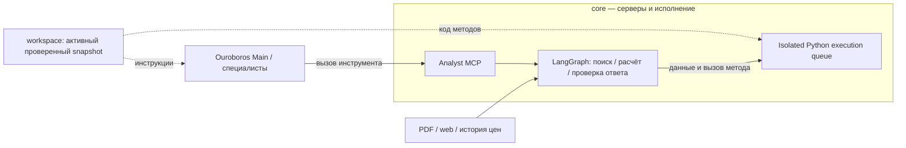

# Архитектура

Оба MCP-сервера находятся в `core`. Репозиторий `evolution` хранит инструкции,
Python-алгоритмы инструментов и policies, которые агент может предлагать изменить.
Название **Evolution MCP** обозначает сервис работы с этим Git, а не его расположение.

## Выполнение запроса

## Изменение методов и скиллов

Например, `search_reports` зарегистрирован в `core`, а `query_strategy.py`,
`chunking.py` и `reranking.py` находятся в `evolution`. Их рабочая версия берётся
из выпущенного snapshot. Изменения кандидата не попадают в исполнение автоматически.

| Часть | Ответственность |
|---|---|
| `core` | Analyst MCP и Evolution MCP, LangGraph, очередь исполнения, LLM/сеть/кеш, контракты, оценка и выпуск |
| `evolution` | `SKILL.md`, forecast/scenario, chunking/reranking/query_strategy, search_strategy и policies |
| `workspace` | Files/Reports/Prices/Models, индексы, диалоги, traces и snapshots; вне Git |

## Решения

- **Report-first:** отчёты основные, web дополняет пробелы и свежие данные. Ссылки и даты разделены.
- **RAG:** HyDE + multilingual E5/Chroma/BM25. Гипотетический текст влияет только на поиск;
  цитаты и числа проверяются по PDF. Это не полная смысловая проверка ответа.
- **Прогноз:** ARIMA/ETS на log месячной цены; выбор на calibration, проверка на test, сравнение с naive.
  История кешируется по диапазонам. Supply-cut — чувствительность по явным допущениям пользователя.
- **Изоляция:** `run(request)` возвращает проверяемые значения, spans или индексы, а не ссылки.
  Python не импортируется в MCP. Executor использует chroot/UID/seccomp, лимиты и очередь;
  host mounts, Docker socket и модельных секретов у job нет. Уязвимости ядра этим не исключаются.
- **Доступ:** backend проверяет включение скилла и актуальность review. Недоступный UI блокирует вызовы.
  Новый MCP-tool требует владельца в `config/capabilities.json`.

## Самоулучшение

Из чата доступны policy, инструкции и шесть Python slots. Проверки требуют прироста без регрессий,
затем идут critic и [операторский выпуск](README.md#выпуск-навыков). Native auto post-task evolution выключен.
Новый инструкционный скилл использует существующие инструменты; новый backend-tool требует разработчика.

Пакет фиксируется одним snapshot на запрос; изменённый chunking получает отдельный индекс.
RAG-оценка использует записанные генерации Lite. Новому prompt нужны подходящие записи владельца;
без них оценка недоступна. Кейсы известны при разработке и не являются blind holdout.

## Ограничения и TODO

Корпус — два отчёта; прогноз — Brent на 1–6 месяцев с номинальными 80% интервалами.
Котировки Brent/WTI — delayed futures, не spot. Единого денежного лимита нет;
во время stage аналитика закрыта до review/enable. [Измеренные результаты](docs/VALIDATION.md).

- Расширить корпус и независимую оценку полноты ответов; улучшить калибровку интервалов.
- Полностью вынести алгоритмический RAG-пайплайн в `evolution`: порядок шагов, стратегии поиска,
  смешивание эмбеддингов, расширение страниц, отбор контекста и промпты синтеза.
  В core оставить MCP, контролируемый доступ к LLM/хранилищам/сети, секреты, кеш, бюджеты,
  изоляцию и проверку доказательств. Версионировать пайплайн и совместимость индекса;
  перед выпуском проверять весь путь от запроса до ответа, качество, стоимость и регрессии.
  Сейчас перенос частичный; этот пункт описывает будущую реализацию.
- Создавать из чата новые Python-модули/MCP-tools через `evolution/tools/`:
  manifest со схемами и владельцем-скиллом, реализация, инструкции, изолированные проверки,
  native review, подтверждение владельца, discovery и откат. Сеть, секреты и зависимости требуют
  отдельных разрешений. Этот механизм пока не реализован.
