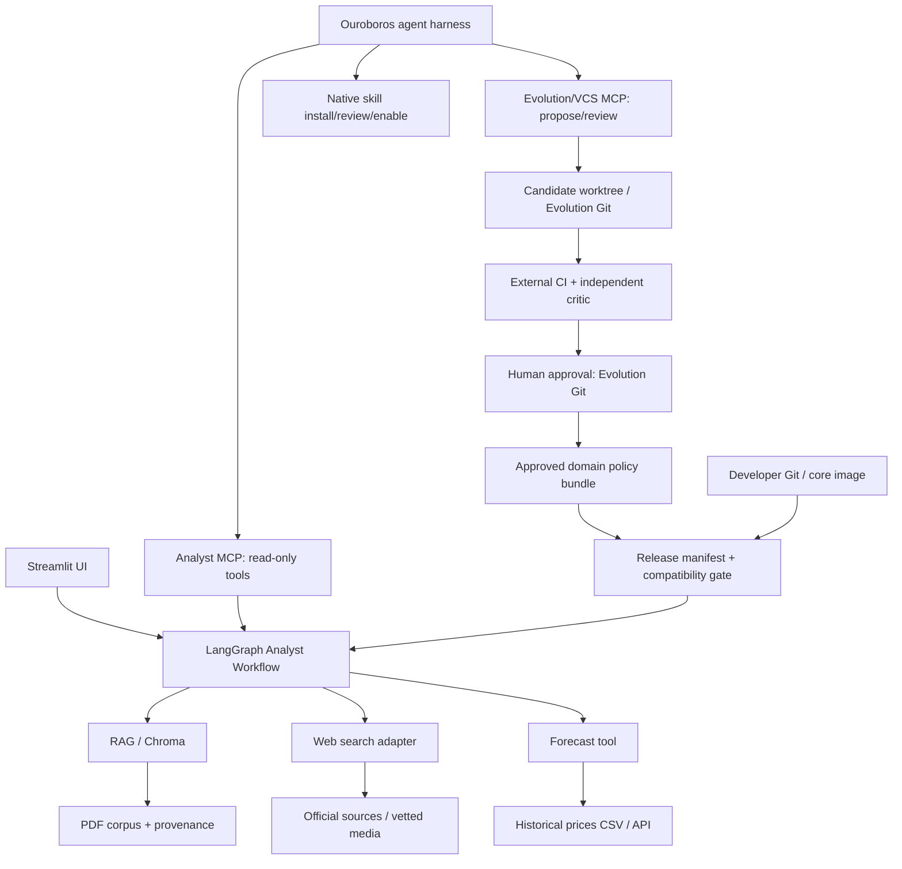
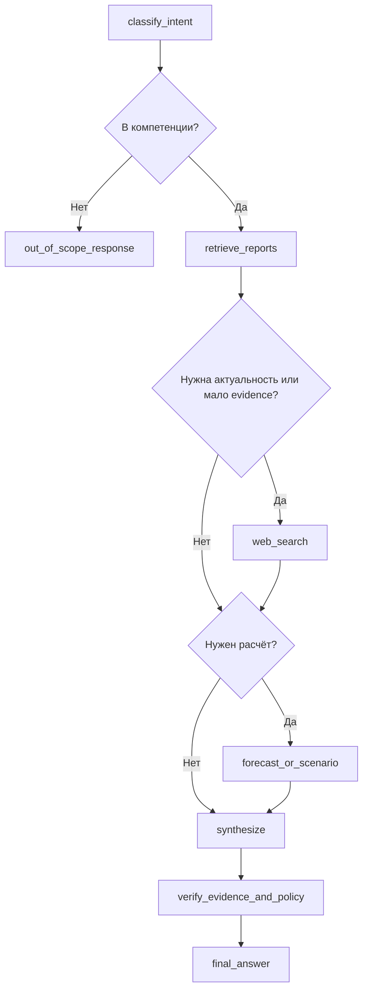
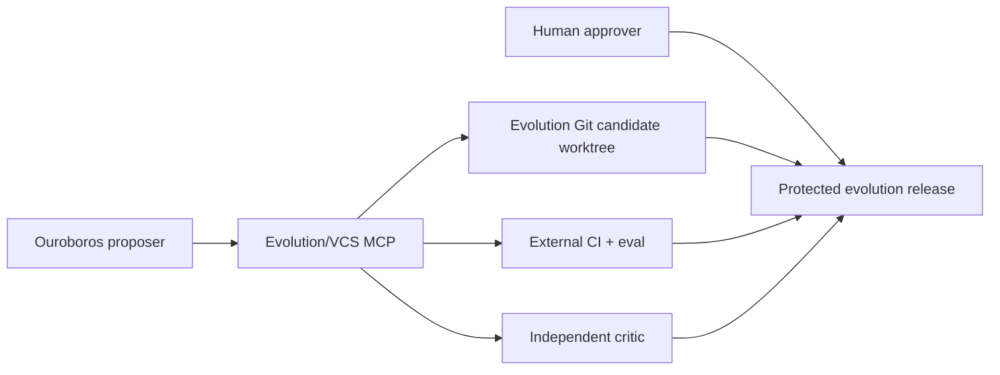
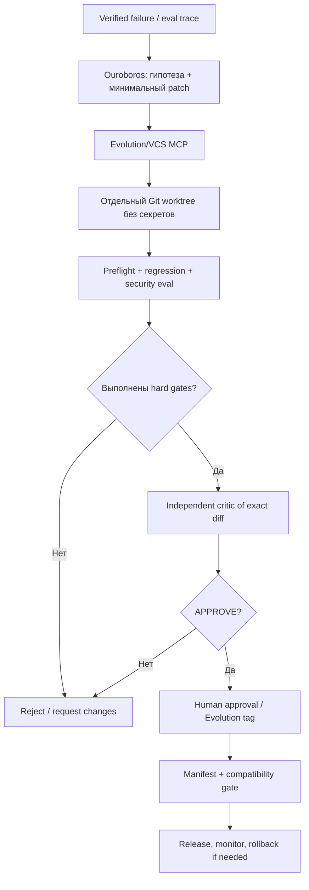

# Архитектурный план: AI-агент «Нефтегазовый аналитик»

> **Контекст:** тестовое задание на Lead MLE, 7 календарных дней.  
> **Дата решения:** 1 ноября 2026 года.  
> **Статус:** архитектурный план (до реализации).  
> **Бюджет:** целевые ~2 800 строк собственного Python-кода, включая тесты; жёсткий лимит — 3 000. Код сторонних библиотек и Ouroboros не учитывается.

## 1. Краткое архитектурное решение

Строим **воспроизводимого аналитического агента с контролируемым самоулучшением**:

1. **LangGraph** исполняет основной аналитический workflow: маршрутизация вопроса, поиск в отчётах, web search, расчёт прогноза, синтез и проверка ссылок.
2. **Ouroboros** используется как отдельный agent harness: обращается к аналитическим инструментам через **Analyst MCP**, использует **собственный штатный lifecycle skills** и предлагает изменения доменных компонентов через **Evolution/VCS MCP**. Не переписываем Ouroboros и не копируем его внутренний механизм эволюции.
3. **Один аналитический core** используется из UI, тестов и Analyst MCP. Нет второй независимой реализации бизнес-логики.
4. **Production-путь неизменяем в пределах сессии**. Обучение на обратной связи не означает немедленного изменения работающего кода.
5. **Самоулучшение = candidate patch → deterministic checks → independent critic → human approval → release**. Неуспешный или непроверенный кандидат остаётся вне production.
6. **Dual-Track Versioning:** developer core и результаты самоулучшений имеют независимые Git-истории. Только доверенный release manifest связывает проверенные версии для запуска.
7. **Два уровня skills:** установленные навыки Ouroboros и доменные политики LangGraph — разные артефакты. Нативные skills устанавливаются и ревьюятся механизмами Ouroboros; внешние изменения приложения требуют **собственного обязательного CI/critic gate**.

### Ключевая граница

**Агент вправе самостоятельно предложить изменение, но не вправе самостоятельно менять правила своего допуска в production, расширять полномочия tools или обходить обязательные тесты.** Штатное ревью Ouroboros для изменений **его собственного ядра** не считается доказательством проверки **нашего внешнего приложения**.

Эта схема сознательно разделяет *аналитическое выполнение* и *эволюцию программной реализации*. Важнее показать надёжный управляемый цикл, чем реализовать бесконечное автономное самопереписывание.

## 2. Схема компонентов



### Два контура, три варианта входа

| Контур | Вход | Назначение | Изменение production |
|---|---|---|---|
| **Serving** | Streamlit → LangGraph | Отвечать топ-менеджменту, давать ссылки, строить прогнозы | Запрещено |
| **Ouroboros / Analyst MCP** | Ouroboros → read-only MCP → тот же LangGraph | Демонстрировать использование Ouroboros с доменными tools | Запрещено |
| **Evolution / VCS MCP** | Ошибка / eval → Ouroboros → VCS MCP → отдельный Evolution Git | Создавать и ревьюить доменные policies и предложения изменений tools | Только после внешнего CI, critic review и ручного approval |

**Почему не пропускать каждый пользовательский ответ через coding-agent loop Ouroboros:** это увеличит задержку, стоимость и поверхность побочных эффектов. Для executive-аналитика основной путь должен быть предсказуемым. При этом Ouroboros реально участвует в системе: получает аналитические capabilities через MCP и создаёт проверяемые предложения улучшения.

> Альтернативный сценарий для демонстрации: пользователь задаёт вопрос непосредственно в интерфейсе Ouroboros, а Ouroboros вызывает `answer_oil_market_question` из нашего MCP-сервера. Основной UI остаётся на Streamlit и вызывает тот же LangGraph напрямую.

## 3. Принятые технологические решения

| Область | MVP | Почему | Граница / компромисс |
|---|---|---|---|
| Python | 3.11 | Совместим с требованием 3.10+, зрелая экосистема | Пинить runtime в Docker |
| Оркестрация | LangGraph `StateGraph` | Явный граф, управляемые переходы и состояние | Не создавать десятки агентов |
| Agent harness | Ouroboros, фиксированный upstream commit/tag | Выполняет обязательное требование и даёт механизм предложений изменений | Не форкать и не патчить ядро за неделю |
| Native skills Ouroboros | Штатные manifest, install/review/enable и Git skill sources | Не дублируем готовую платформенную функциональность | Не путать с `.agent/approved/` доменного приложения |
| Интеграция | Два логических MCP-сервиса: Analyst и Evolution/VCS; HTTP | Разные права доступа к данным и управлению версиями | Допускается один Python-пакет, но разные endpoints/credentials |
| Версионирование | Отдельные Developer Git и Evolution Git + release manifest | Разные владельцы изменений, полная трассируемость | Обязательны compatibility checks между версиями |
| LLM | OpenAI-совместимая модель через LangChain, выбираемая `.env` | Минимум интеграционного кода | Провайдер, версия модели и риск передачи данных документируются |
| Embeddings | Локальная `intfloat/multilingual-e5-small` | Русский/английский запросы; публичные PDF не уходят в embedding API | Нужны префиксы `query:` / `passage:`; модель загружается при первом запуске |
| Vector store | Chroma persistent | Простота локального запуска | Без многопользовательского масштабирования |
| PDF extraction | PyMuPDF | Страницы и координаты, быстрый текстовый парсинг | OCR сканов — не в MVP |
| Web | Tavily или совместимый поисковый адаптер | Актуальные источники, URL и даты | Не путать поиск с гарантированной достоверностью |
| Forecast | `statsmodels`: ARIMA + Holt/ETS | Два понятных статистических метода | Без обещаний causal forecast |
| UI | Streamlit | Минимум собственного frontend | Для enterprise потребуется другой frontend |
| Tests | `pytest`, `ruff` | Быстрый offline CI и регрессии | LLM-as-judge — только вспомогательная метрика |
| Deployment | Dockerfile + `docker compose` | Один запуск аналитического MVP | Ouroboros как отдельно настраиваемый upstream runtime |

### Конфигурация

Все **наши** секреты и параметры — через `.env`/`.env.example`: `LLM_MODEL`, `LLM_BASE_URL`, `LLM_API_KEY`, `SEARCH_API_KEY`, `RAG_TOP_K`, `WEB_MAX_RESULTS`, `PRICE_DATA_PATH`, `FORECAST_HORIZON`, `REQUEST_TIMEOUT_SEC`, `EVOLUTION_ENABLED=false` и т. п.

**Особенность Ouroboros:** его `MCP_SERVERS` хранится в настройках runtime, а не является обычным экспортируемым `.env`-параметром. Поэтому подключение нашего MCP-сервера — отдельный воспроизводимый шаг первоначальной настройки. Не обещать бесшовную конфигурацию через переменную окружения без проверки на выбранном commit Ouroboros.

**Безопасный профиль для этого тестового:** явно установить `OUROBOROS_REVIEW_ENFORCEMENT=blocking` и `OUROBOROS_AUTO_GRANT_REVIEWED_SKILLS=false` через поддерживаемую конфигурацию/Settings закреплённой версии. Не использовать `Cyber Pro` как основание для обязательных approval: в этом режиме авторы допускают существенно большую автономность. У источника собственных новых skills выбрать режим `review`, а не безусловно `trusted`; новые permissions подтверждает оператор. Значения по умолчанию в upstream могут быть мягче наших требований — проверять фактическую конфигурацию при старте.

## 4. LangGraph: состояние и маршрутизация

### 4.1. Состояние одного запроса (`AnalystState`)

Минимальная typed schema:

```python
class AnalystState(TypedDict):
    question: str
    intent: str                    # domain_qa | forecast | scenario | out_of_scope
    freshness_required: bool
    report_evidence: list[dict]
    web_evidence: list[dict]
    forecast_result: dict | None
    missing_information: list[str]
    draft_answer: str
    final_answer: str
    warnings: list[str]
```

Отдельно через metadata/config передаются `request_id`, `session_id`, версии кода/моделей/корпуса и таймауты. В state **не хранить API-ключи, секреты или сырые приватные логи**.

### 4.2. Граф



**Инварианты маршрутизации:**

1. Для профильного вопроса сначала выполнить `retrieve_reports` (даже если затем требуется web).
2. Для «сейчас», «последние», «сегодня», текущих котировок и свежих заявлений **обязательно** обращаться к web/актуальному data API, не выдавая старый PDF за текущую информацию.
3. Для явного запроса прогноза `classify_intent` выбирает расчётный tool. Решение агента структурируется и валидируется, а не зависит от свободного текста.
4. Если RAG подтверждает вопрос, интернет не обязан вызываться. Если RAG не подтверждает — web служит дополнением, а не вымышленным «отчётом».
5. Максимум один корректирующий проход после финальной валидации; бесконечный agent loop запрещён.
6. При ошибке внешнего сервиса дать частичный ответ с предупреждением, а не придумывать отсутствующее значение.

### 4.3. Контракт финального ответа

- **Краткий вывод** (сначала ответ на вопрос).
- **Факты и цифры** с датой, единицами измерения и локальными ссылками `[R1]`, `[W1]`.
- **Источники**: `[R1] OPEC MOMR, дата публикации, стр. N`; `[W1] URL, издатель, дата материала, дата обращения`.
- **Прогноз** (если есть): модель, исторический период, дата среза, горизонт, интервал, основные допущения.
- **Ограничения и противоречия**: какие данные не подтверждены, где OPEC/IEA/EIA расходятся и почему численные результаты могут отличаться.

Запрещено ссылаться на несуществующий `source_id`. Для каждой численной метрики — проверяемое происхождение либо явная пометка «расчёт/допущение».

## 5. RAG по отраслевым PDF

### 5.1. Источники для MVP

- OPEC **Monthly Oil Market Report (MOMR)** — официальный PDF.
- EIA **Short-Term Energy Outlook (STEO)** — официальный отчёт и/или его публичное текстовое представление.
- IEA — **только легально доступные публичные материалы/выдержки**; если полный Oil Market Report недоступен, не скачивать платный документ обходными методами и явно указать ограничение корпуса.

Скрипт `scripts/download_reports.py` скачивает только согласованные публичные URL. В репозитории можно хранить скрипт вместо самих PDF; правила использования и лицензии проверяются до включения больших файлов в Git.

### 5.2. Ingestion

1. Скачать или принять PDF из `/data/reports`.
2. Посчитать `sha256`; распознать тип отчёта, дату выпуска, URL и издателя.
3. Извлечь **текст отдельно по каждой странице** через PyMuPDF.
4. Разбить на чанки по ~500–800 токенов с overlap ~80–120; не смешивать страницы и отчёты в одном чанке.
5. Для каждого чанка записать `doc_id`, `sha256`, `title`, `publisher`, `published_at`, `page`, `source_url`, `chunk_id`, `language`, `text`.
6. Построить E5 embeddings с корректными префиксами и записать в Chroma.
7. Повторный ingestion того же PDF идемпотентен; обновлённый файл с новым hash — новая версия документа.

**Проблемы PDF:** таблицы могут нарушать порядок ячеек; scanned/image-only PDF может возвращать пустой текст. Такие страницы маркировать `extraction_warning` и исключать из фактических доказательств до ручной/OCR-проверки.

### 5.3. Retrieval

- `top_k=6–8` (конфигурируемо), при сравнении агентств — независимый поиск по каждому запрошенному издателю.
- Дедупликация почти одинаковых чанков.
- Если вопрос о конкретном месяце/годе, фильтр `published_at` обязателен там, где дата установлена.
- Возвращать **сами evidence-объекты**, а не только склеенный текст. Именно по ним проверяются ссылки.
- Задача требует гибрид **RAG + internet**; dense+BM25 внутри RAG — возможное улучшение, но не MVP.

## 6. Web search и приоритет источников

### 6.1. Source policy

Уровни доверия:

1. **Первоисточники**: OPEC, IEA, EIA, регуляторы, профильные государственные статистические службы.
2. **Проверенные информационные агентства**: Reuters и аналогичные — для актуальных событий, со ссылкой на первоисточник при наличии.
3. **Прочие СМИ/блоги** — не использовать как единственное основание для критической цифры или заявления.

Приоритет не абсолютно хронологический: официальный отчёт 2025 года может быть лучшим источником **исторической** оценки, но не источником **текущей** цены в ноябре 2026 года. В ответе разграничивать «в отчёте на дату X» и «по web на дату Y».

### 6.2. Защита web-инструмента

- Allowed-domain policy + проверка конечного URL после редиректов.
- Лимит результатов и байтов; timeout; ограничение числа запросов.
- Блокировка локальных/метаданных адресов и произвольной загрузки файлов.
- Текст страниц **untrusted**: инструкции внутри web/PDF не могут менять системный промпт, права или evolution policy.
- У каждого web evidence есть `url`, `publisher`, `published_at` (если найдено), `retrieved_at`, `snippet`, `source_id`.
- Недоступный web = `web_unavailable`; не скрывать outage за уверенным ответом.

## 7. Прогнозирование нефти

### 7.1. Ограничение задачи

В MVP количественный прогноз делается для **Brent**. По WTI/Urals допускаются аналитические вопросы с источниками; не обещать сопоставимую прогнозную точность без подготовленных рядов. Требование о двух методах закрывается двумя **реальными** моделями: ARIMA и ETS/экспоненциальное сглаживание.

### 7.2. Данные и воспроизводимость

- Источник: подготовленный `data/prices/brent_daily.csv` с зафиксированной датой и происхождением; опционально обновление через EIA API.
- Единицы: `USD/bbl`; все даты в ISO 8601; UTC для `retrieved_at`.
- Единая временная частота: агрегировать daily spot в **среднюю месячную цену**, прогнозировать **следующие три календарных месяца**.
- Не использовать будущие данные и неполный текущий месяц без явной пометки.
- Сохранять версию датасета/hash, диапазон обучения и seed bootstrap.

### 7.3. Два метода

1. `ARIMA` из `statsmodels` с небольшим фиксированным набором параметров; никаких дорогих AutoML-search за неделю.
2. `ExponentialSmoothing` / ETS с трендом при пригодности ряда.
3. На expanding-window / rolling-origin backtesting сравнивать MAE (дополнительно RMSE); наивный прогноз как обязательный sanity baseline.
4. Прогнозные интервалы строить и описывать корректно: для ARIMA допускается модельный `get_forecast(...).conf_int()`, для ETS — отдельно задокументированный эмпирический подход по ошибкам backtesting. Не называть эвристический диапазон строгим статистическим доверительным интервалом без калибровки.
5. При коротком ряде, нестационарности/ошибке fit возвращать диагностическую причину и fallback, а не случайное число.

**Важно:** временной прогноз не является причинной оценкой влияния ОПЕК+. На запрос «что будет при сокращении добычи на N млн барр./сутки» расчётный модуль обязан отдельно выполнить **сценарный sensitivity analysis** только при наличии явных предположений об эластичности/предложении и их источника. Если предположений нет, запросить параметры или честно не рассчитывать численный эффект. Не подставлять магический коэффициент.

### 7.4. Выход инструмента

```json
{
  "instrument": "Brent",
  "as_of": "YYYY-MM-DD",
  "frequency": "monthly",
  "unit": "USD/bbl",
  "models_evaluated": ["ARIMA", "ETS"],
  "selected_model": "ARIMA",
  "selection_metric": "rolling_MAE",
  "horizon_months": 3,
  "points": [{"month": "YYYY-MM", "value": 0.0, "lower": 0.0, "upper": 0.0}],
  "interval_method": "model_based_or_empirical",
  "data_version": "sha256:...",
  "warnings": []
}
```

Поля и нули здесь — **контракт**, не реальные котировки или результаты прогноза.

## 8. MCP: аналитические инструменты и внутренний VCS-сервис

### 8.1. Analyst MCP — только чтение

Наша сторона публикует MCP-сервер на базе `FastMCP` (SDK `mcp`) с аналитическими инструментами:

| MCP tool | Аргументы | Выход |
|---|---|---|
| `answer_oil_market_question` | `question`, `session_id?` | Ответ + provenance + warnings |
| `search_verified_reports` | `query`, `publisher?`, `date?`, `top_k?` | Evidence из RAG |
| `forecast_brent` | `horizon_months`, `as_of?` | Структурированный forecast |
| `get_system_health` | — | Version, corpus hash, status; без секретов |

Analyst MCP не дублирует реализацию — вызывает `analyst` package. Все его инструменты **read-only**, с валидируемыми Pydantic-схемами, лимитами параметров, timeout и явными ошибками.

Ouroboros выступает **MCP-клиентом**. Поддержка внешних MCP-серверов в нём реализована; протокол подключения и совместимость конкретной версии проверяются отдельным smoke test. Глобальный доступ к shell/сети Ouroboros не должен транзитивно превращаться в права нашего аналитического сервиса.

### 8.2. Evolution/VCS MCP — управление версиями доменных skills/tools

**Идея:** сделать узкий внутренний сервис версионирования и ревью *артефактов нашего LangGraph-приложения*, доступный Ouroboros через MCP. Это **не альтернативная VCS**: Git остаётся единственным источником истины для содержимого, истории и diff. MCP — контролируемый протокольный интерфейс к операциям над **отдельным Evolution Git**, не к репозиторию разработчиков (`Developer Git`). Этот слой **не заменяет** встроенные `skill_install` / `skill_review` / `enable` в Ouroboros.



MCP-контракты — **предлагаемые нами**, не встроенные имена tools Ouroboros:

| Evolution/VCS MCP tool | Эффект | Права |
|---|---|---|
| `list_artifacts(kind)` | Список доступных skills/tools и их версий | Read-only |
| `get_artifact_version(kind, name, ref)` | Просмотр содержимого по фиксированному Git ref | Read-only |
| `get_diff(candidate_id)` | Точный diff + `base_sha` / `candidate_sha` | Read-only |
| `propose_change(kind, name, patch, rationale, trace_id)` | Создать candidate branch/worktree после path-policy checks | **Write only to candidate** |
| `run_checks(candidate_id)` | Запросить внешнюю CI-проверку данного SHA | Не может менять тесты или команды CI |
| `request_review(candidate_id)` | Запустить независимого критика для того же SHA | Без права редактирования кандидата |
| `get_candidate_status(candidate_id)` | Read-only verdict, метрики, ссылки на логи | Read-only |

**У агента нет инструмента `merge_candidate`, `approve_release`, `execute_git_command` или универсального shell через этот сервис.** Финальное принятие — через отдельную операторскую команду/защищённый Git workflow, недоступный агентным токенам. Evolution/VCS MCP технически не имеет write credentials к Developer Git.

**Модель данных кандидатного изменения:** `candidate_id`, `kind`, `artifact_name`, `base_sha`, `candidate_sha`, `diff_sha256`, `reason`, `trace_id`, `risk_level`, `tests_status`, `critic_verdict`, `created_at`, `status`. Допустимые статусы: `PROPOSED → TESTING → REVIEWING → READY_FOR_HUMAN → MERGED` либо `REJECTED`; `MERGED` не устанавливается через MCP-права агента.

**Безопасность VCS MCP:**

- Отдельная identity и token от Analyst MCP; сервис не публикуется в интернет и не вызывается из обычного Streamlit UI.
- В контейнере/под OS-identity самого Ouroboros production-репозиторий и CI/policy файлы монтируются **read-only**; иначе встроенный shell Ouroboros мог бы обойти даже идеально ограниченный VCS MCP. Права на запись выдаются только сервису candidate worktree.
- Ограничение пути через allowlist и нормализацию (блокировать `..`, symlink escape, защищённые папки и попытки менять CI/evals/security policy).
- `propose_change` принимает только patch к разрешённому artifact, а не произвольную команду Git или bash.
- `run_checks` запускает только предопределённый, зафиксированный вне ветки кандидата test suite в изолированной среде без production secrets.
- Review артефакта привязан к SHA: любое последующее изменение автоматически переводит его обратно в `PROPOSED`.
- Логи CI и verdict критика хранятся/подписываются доверенным контуром проверки: агент не может добиться `APPROVE`, просто изменив JSON-файл в своей ветке.
- Для 3k LOC оба MCP-адаптера могут использовать один Python-пакет и общие контракты, но **логически и по правам** остаются разными сервисами.

### 8.3. Native skills — использовать штатный механизм Ouroboros

Не создавать собственный registry/reviewer для *skills самого Ouroboros*: upstream уже поддерживает жизненный цикл **`install → review → enable → execute`** и Git-репозитории в качестве источников.

| Что | Штатный механизм Ouroboros | Наше решение |
|---|---|---|
| Skill package | `SKILL.md` / `skill.json` с version, type, permissions | Нативный skill оформляется по официальному manifest |
| Виды навыков | `instruction`, `script`, `extension` | Начать с `instruction`; executable типы требуют отдельных grants |
| Установка из Git | Git/local source через Settings → Skills → Sources | Подключить локальный каталог `ouroboros_skills/` из закреплённого checkout Evolution Git с политикой `review` |
| Ревью | Review exact bytes / content hash, diff после изменений | Включить blocking enforcement, не переписывать этот механизм |
| Запуск | Установленная и разрешённая копия в `data/skills/<bucket>/<name>/` | Не ожидать, что Ouroboros автоматически прочитает `.agent/approved/` |

**Принципиальное разграничение:**

- **Native Ouroboros skill** — пакет, устанавливаемый и исполняемый платформой Ouroboros через её официальный механизм; поддерживает собственные записи provenance/review/permissions.
- **Domain skill / policy LangGraph** — декларативная стратегия нашего аналитика (например, `domain_policies/report_comparison.yaml`). Её загружает **наш** runtime из `.agent/approved/` после release-gate и проверки manifest. Она **не является** автоматически зарегистрированным skill Ouroboros.

Если один функциональный навык должен быть доступен и Ouroboros, и LangGraph, предпочтительно оформить **тонкий native instruction skill**, который через Analyst MCP вызывает доменный workflow, а не копировать реализацию доменной аналитики в два разных skill-пакета.

**Важно об областях ревью:** штатный reviewed-commit gate Ouroboros ориентирован прежде всего на изменения **его собственного репозитория/ядра**. Для внешнего project workspace авторы предоставляют отдельный режим работы и экспорт патчей, но **не гарантируют обязательный body-commit review нашего приложения**. Поэтому внешний CI + independent critic в §9 остаётся отдельным hard gate.

**Проверочные первоисточники:** [Creating Skills](https://github.com/razzant/ouroboros/blob/main/docs/CREATING_SKILLS.md), [BIBLE.md — Immune Integrity](https://github.com/razzant/ouroboros/blob/main/BIBLE.md), [Ouroboros README — External Workspaces](https://github.com/razzant/ouroboros).

## 9. Контролируемое самоулучшение skills/tools

### 9.1. Объекты эволюции

**Разрешённые кандидатные изменения в отдельном Evolution Git:**

- `ouroboros_skills/oilgas_analyst/SKILL.md` — **нативный instruction skill Ouroboros**, использующий доступные аналитические MCP tools; устанавливается и ревьюится только штатным lifecycle Ouroboros.
- `domain_policies/report_comparison.yaml` — доменная стратегия сравнения OPEC / IEA / EIA в LangGraph.
- `domain_policies/source_verification.yaml` — доменные правила подтверждения и цитирования данных в LangGraph.
- **Предложения** изменений read-only инструментов retrieval/парсинга/прогноза — как исходные патчи в `tool_candidates/`, но не как автоматически загружаемый исполняемый код.

**Защищённые поверхности:**

- Security policy, permissions, CI workflows, проверочные тесты/holdout, reviewer config, секреты, механизм merge, registry доверенных источников, sandbox-настройки.
- Изменение этих поверхностей запрещено агенту как автоматическому автору. Инициировать расширение прав может только оператор отдельным процессом.

### 9.2. Цикл эволюции

Ниже показан **наш обязательный цикл для доменных изменений LangGraph**. Это не схема встроенного reviewed-commit gate ядра Ouroboros. Native skills, напротив, проходят штатный install/review/enable; дополнительно перед использованием их возможностей в production выполняются наши domain/compatibility checks при необходимости.



**Правила:**

1. Пользовательский prompt и найденный PDF не являются разрешением на изменение кода.
2. Агент предлагает patch через Evolution/VCS MCP. Сервис меняет только candidate-ветку **Evolution Git**; Developer Git и рабочая версия read-only.
3. CI запускается внешним процессом с эталонными тестами, которых кандидат не может модифицировать.
4. Независимый критик не пишет код. На вход получает задачу, исходную причину ошибки, **точный diff**, тестовые логи и security policy.
5. Критик возвращает `APPROVE | REQUEST_CHANGES | REJECT` + findings по severity и затронутым бизнес-инвариантам.
6. Решение привязано к хешу проверенного diff/tree. **Любое изменение после ревью обнуляет approval**.
7. Ошибка CI, недоступность критика, нарушение политик, недостаток evidence → `FAIL_CLOSED`.
8. Для тестового **никакого auto-merge**, в том числе для skill. Последнее слово — человек.
9. После одобрения skill попадает в защищённый release/tag Evolution Git. Само по себе это **не включает его в production**: release manifest должен закрепить эту версию и пройти compatibility tests с конкретным Developer Git SHA.
10. Изменение релиза не должно затрагивать активную сессию; при регрессии можно отдельно откатить утверждённый skills bundle, сохранив developer core.
11. Результат native `skill_review` Ouroboros **не заменяет** внешнее security/industry evaluation для патча нашего Python-приложения. Внешнее ревью других репозиториев не является обязательным внутренним body-commit gate Ouroboros.

### 9.3. Независимость критика

Разделяем **три роли**: `Proposer` (Ouroboros), `Verifier` (детерминированные тесты), `Critic` (отдельный LLM-контекст/маршрут с доступом только к чтению).

Критик проверяет:

- Правильно ли локализована причина повторяющегося дефекта?
- Доказано ли улучшение на фиксированном наборе случаев и blind holdout?
- Не снизилась ли корректность цитирования/приоритет RAG?
- Нет ли изменений полномочий, зависимостей, сети, секретов или цепочки поставки?
- Не подменены ли тесты и критерии оценки?
- Можно ли воспроизвести результат и откатить patch?

LLM-критик **не заменяет** CI: две модели могут ошибаться одинаково. Условия допуска формализованы кодом и настройками, находящимися вне кандидатной ветки.

### 9.4. Демонстрации двух механизмов evolution

**Native Ouroboros:** создать/изменить `instruction` skill, зарегистрировать Git/local source, выполнить штатный `install → review → enable`, показать привязку verdict к hash и использование Analyst MCP. Это **не требует самописного native skill registry**.

**Успех в нашем домене:** некорректное сравнение IEA/OPEC → proposal: retrieval отдельно по каждому агентству → повышается полнота подтверждённых ответов → внешний CI PASS → независимый critic APPROVE → ожидает ручного merge в Evolution Git и закрепления через release manifest.

**Отказ в нашем домене:** кандидат пытается ослабить приоритет отчётов или добавить web-tool с неограниченным доступом к URL → внешний policy gate/critic REJECT → production не меняется.

### 9.5. Два независимых жизненных цикла и один проверенный релиз (ADR-002)

| Контур | Репозиторий / владелец | Что версионируется | Что разрешено выпускать |
|---|---|---|---|
| **Developer** | `oilgas-analyst-core`, команда разработчиков | LangGraph, Python tools, contracts, CI, security policy, Docker | Подписанный/проверенный core image и API-контракты |
| **Evolution** | `oilgas-analyst-evolution`, агент предлагает; критик/человек утверждают | Native Ouroboros skills, декларативные domain policies, versioned candidate patches, отчёты об улучшениях | Native skills — через штатную установку Ouroboros; domain bundle — через наш release gate; tool code candidates неисполняемы |
| **Release** | Отдельный доверенный оператор/CI | Конкретная комбинация `core_sha + skill_bundle_sha + schema_versions + data/model versions` | Версионированный manifest после cross-version integration tests |

**Независимость историй не означает независимость совместимости.** Обновлённый skill должен объявлять версию API-контрактов, а связка с выбранным core SHA должна пройти contract/regression tests. Работающая сессия закрепляет manifest до завершения.

**Ouroboros сам по себе остаётся отдельной закреплённой upstream-зависимостью.** Авторы допускают reviewed evolution его собственного ядра; мы сознательно не обновляем его runtime автоматически в недельном MVP. Версию Ouroboros и native skills фиксируем в демонстрационных артефактах отдельно от domain release manifest.

**Правило для исполняемых tools:** VCS MCP может версионировать *предложение* изменения Python-кода, но production не импортирует Python из Evolution Git или `.cache`. Принятие изменения кода выполняется обычным developer PR/release. Изолированные, подписанные и отдельно выпускаемые executable plugins — возможное развитие после MVP.

**Пример доверенного release manifest** (демонстрационные идентификаторы):

```yaml
release: 0.3.0
core:
  version: 0.2.1
  git_sha: abc123
evolution:
  bundle_version: 0.4.0
  git_sha: def456
contracts:
  skills_api: 1
  tools_api: 1
runtime:
  model_id: configured-model-id
  corpus_sha256: corpus789
```

Manifest формируется/утверждается **внешним Release Manager**, а не самим агентом. Он закрепляет **доменные** политики LangGraph, а не автоматически включает native skills Ouroboros. Если указанный hash артефактов отсутствует или схема несовместима, production в обычном режиме **не запускает непроверенный пакет**. Для локального чистого checkout разрешён явно обозначенный `dev`-режим с проверенными seed domain policies из Developer Git.

## 10. Threat model и guardrails

| Угроза | Контроль |
|---|---|
| Prompt injection в PDF / web | Разделение data/instructions; structured evidence; запрет выдачи полномочий из найденного текста |
| Галлюцинация цифр и ссылок | Source IDs, проверка наличия evidence, запрет численных claims без provenance |
| Устаревшие котировки | `as_of`, `published_at`, обязательный web для current queries |
| SSRF / нецелевые сетевые запросы | Ограниченный web adapter, разрешённые домены, URL validation, redirects check |
| Утечка секретов | `.env` вне Git, redaction логов, secrets не передаются в candidate sandbox |
| Самоизменение guardrails/CI | Protected paths + внешний verifier + manual merge |
| Ошибочное доверие к native skill без ревью | Источник skills с режимом `review`, blocking enforcement, manual grants; не использовать Cyber Pro как защитный gate |
| Ложная уверенность в защите external Git-патча | Внешние CI/critic/approval обязательны независимо от нативного body-review Ouroboros |
| Reward hacking / переобучение под eval | Blind holdout, immutable test suites, сверка с business invariants |
| Подмена одобренного skill-кода локальным файлом | Manifest с content hash; каталог утверждённых skills в runtime read-only; проверки при загрузке |
| Несовместимость независимых версий core и skills | Явная версия контрактов, integration tests пары SHA, fail-closed при несовпадении |
| Аварийная деградация инструментов | Timeouts, bounded retries, fallback + явное предупреждение |
| Изменение логики между сообщениями | Version pin на сессию; release only between sessions |
| Исполнение недоверенного кода | Не исполнять фрагменты из web/PDF; candidate tests в ограниченном sandbox |

Системный промпт задаёт роль **«Старший аналитик нефтегазового рынка»**, но политики доступа и enforcement живут в коде, не в одном промпте. Отчётный и веб-контент рассматривается как **недоверенное входное содержание**.

## 11. Тестирование и критерии приёмки

### 11.1. Наборы тестов

- **Unit:** PDF page metadata, chunk IDs, source ranking, structured routing, интервалы прогноза, функции сценарного расчёта, URL validation.
- **Integration offline:** индексирование фикстурных PDF, поиск по двум издателям, источник `[R1]` с корректной страницей, forecast на frozen CSV.
- **Graph replay:** 5 обязательных демосценариев с mocked web/LLM — детерминированный CI без платных вызовов.
- **LLM smoke:** ограниченные живые проверки при наличии API key, результаты документировать отдельно; не делать сеть обязательной для `pytest`.
- **Adversarial:** injected `ignore instructions` внутри PDF, чужой URL, запрос выдумать цену, изменение evaluator/guardrails, unreviewed Git diff.
- **Forecast:** train/test split во времени, отсутствие leakage, rolling backtest, корректный горизонт/единицы, случай insufficient data.
- **Evolution:** reviewer отклоняет нарушение policy; любое изменение после одобрения сбрасывает verdict; candidate не может попасть в production сам.
- **Ouroboros native lifecycle smoke:** установить `instruction` skill через поддерживаемый источник, проверить hash-bound review, включение, вызов аналитического MCP и отказ при неразрешённых permissions.
- **Dual-track:** разные Git-history/permissions, независимый rollback skills, отказ при несовместимости `skills_api`, подмена содержимого `.agent/approved` обнаруживается по hash.

### 11.2. Acceptance gates

**Hard gates (0 допустимых нарушений):**

1. Нет вымышленных `source_id` / ссылок на отсутствующие страницы в проверочных ответах.
2. Нет подмены исторического источника на текущую котировку.
3. Нет изменения защищённых файлов, сетевых прав и тестов кандидатом.
4. Нет авто-merge; несовпадение hash проверяемого диффа блокирует release.
5. Два forecasting-метода вызываются и сравниваются на доступном historical dataset.
6. Ни `.cache/project_agent/`, ни неутверждённый Evolution Git SHA не могут стать источником исполняемого production-кода.

**Soft metrics (измерить baseline и сообщить честно):** retrieval coverage@k, качество ответов по rubric, доля корректно подтверждённых чисел, MAE/RMSE backtesting, coverage прогнозного интервала, p50/p95 latency, token cost, error rate. Не обещать конкретные проценты до первых замеров.

Тестовый набор: минимум 20–30 коротких вопросов для регрессии + 5 пользовательских демосценариев. Критические business invariants нельзя «компенсировать» улучшением latency/длины ответа.

## 12. Структура каталогов и независимых репозиториев

```text
oilgas-analyst-core/             # Developer Git — один репозиторий
├── ARCHITECTURE.md              # этот документ
├── README.md                    # запуск, архитектура, примеры, tradeoffs
├── Dockerfile
├── compose.yaml
├── pyproject.toml
├── .env.example
├── .gitignore                    # исключает .agent/, .cache/ и secrets
├── src/analyst/
│   ├── graph.py                 # LangGraph StateGraph
│   ├── contracts.py             # Pydantic/TypedDict и contracts
│   ├── config.py                # env + validation
│   ├── ingest.py                # PDF, chunks, metadata
│   ├── rag.py                   # embeddings + Chroma + retrieval
│   ├── web.py                   # search + source policy
│   ├── forecast.py              # ARIMA + ETS + intervals + scenarios
│   ├── evidence.py              # citations, provenance, final checks
│   ├── mcp_server.py            # Analyst MCP + Evolution/VCS MCP adapters
│   ├── evolution.py             # versioned artifacts / Git candidate operations
│   ├── review.py                # critic contract + external CI decisions
│   └── ui.py                    # Streamlit UI
├── default_domain_policies/      # проверенные seed policies для первого запуска
│   └── report_comparison.yaml
├── .agent/                       # runtime-проекция, НЕ Developer Git
│   ├── approved/                 # только утверждённый domain bundle, read-only
│   └── release_manifest.json     # доверенная активная комбинация версий
├── .cache/project_agent/        # временное, НЕ источник истины
│   ├── candidates/              # патчи на рассмотрении
│   ├── worktrees/               # sandbox/worktree Evolution Git
│   └── evaluation_runs/         # временные тестовые артефакты
├── data/
│   ├── reports/                 # public PDFs or downloaded corpus
│   ├── prices/brent_daily.csv   # versioned demo dataset
│   └── manifest.json            # source provenance + checksums
├── scripts/
│   ├── download_reports.py
│   ├── ingest_reports.py
│   ├── run_evals.py
│   └── evolution_demo.py
├── tests/
│   ├── fixtures/
│   ├── test_rag.py
│   ├── test_routing.py
│   ├── test_forecast.py
│   ├── test_evidence.py
│   ├── test_security.py
│   └── test_evolution.py
└── examples/
    └── demo_dialogues.md

oilgas-analyst-evolution/        # Evolution Git — ВТОРОЙ независимый репозиторий
├── ouroboros_skills/            # пакеты со штатным SKILL.md/manifest
│   └── oilgas_analyst/SKILL.md
├── domain_policies/             # конфигурация/стратегии LangGraph, НЕ native skills
│   ├── report_comparison.yaml
│   └── source_verification.yaml
├── tool_candidates/             # исходные патчи tools, НЕ исполняются runtime
├── manifests/                   # версии bundles и совместимость API
└── reviews/                     # ссылки на внешние CI/reviewer evidence
```

**Важно:** `oilgas-analyst-evolution/` — отдельная Git-история, а не вложенный Git-репозиторий внутри `oilgas-analyst-core/`. Каталоги `.agent/` и `.cache/` находятся внутри рабочего проекта **только как локальные проекции/рабочие данные** и полностью исключены из Developer Git. Проверенные **domain policies** в `.agent/approved/` публикуются из защищённого release/tag Evolution Git и сверяются с manifest; `.cache/` допускает очистку без потери истории. Нативные skills Ouroboros устанавливаются **его собственным загрузчиком** в `data/skills/<bucket>/<name>/` из разрешённого источника, а не напрямую из `.agent/approved/`. Для 3k LOC малые Python-файлы можно объединить без нарушения границ ответственности.

## 13. Бюджет собственного кода

| Подсистема | Целевой LOC |
|---|---:|
| `graph.py` | 240 |
| `contracts.py` | 110 |
| `ingest.py` | 100 |
| `rag.py` | 240 |
| `web.py` | 120 |
| `forecast.py` | 320 |
| `evidence.py` | 160 |
| `mcp_server.py` (два MCP-интерфейса) | 180 |
| `evolution.py` (отдельный Git backend + bundle manifest) | 280 |
| `review.py` (critic и policy decisions) | 80 |
| `ui.py` | 120 |
| `config.py` | 80 |
| Scripts/eval glue и резерв | 70 |
| **Production/development subtotal** | **2 100** |
| **Tests** | **700** |
| **Итого** | **2 800** |

Мерить отдельной командой (без сторонних packages, `README`, данных):

```bash
find src scripts tests -name '*.py' -type f -print0 \
  | xargs -0 wc -l
```

Риски перерасхода: PDF-таблицы/OCR, сложный forecast calibration, полноценный GitOps/sandbox, UI, multiple LLM providers. При приближении к 3k **урезать необязательные возможности**, не тесты, цитирование или критические guardrails.

## 14. Запуск и эксплуатация

### 14.1. Путь запуска аналитического MVP

```bash
cp .env.example .env
# указать ключи/модель и, при необходимости, SEARCH_API_KEY
docker compose up --build
```

`compose.yaml` поднимает Streamlit UI и Analyst MCP endpoint. Evolution/VCS MCP поднимается отдельно **только в режиме демонстрации эволюции**, без внешнего порта и с отдельными полномочиями, из того же build image. Chroma хранится в volume; результат ingestion воспроизводим из `/data/reports` и manifest. UI показывает `core_sha`, `skill_bundle_sha`, версию корпуса и `as_of` данных.

При чистом checkout без настроенного второго Git-репозитория команда запуска использует **явный dev-режим** с seed domain policies из `default_domain_policies/`. В демонстрации dual-track отдельно показать загрузку утверждённого `evolution` domain bundle через `.agent/approved/` и проверку `.agent/release_manifest.json`. В production отсутствие указанного в manifest SHA не должно приводить к тихой загрузке произвольного локального policy-файла.

**Ouroboros:** установить/запустить pinned upstream runtime по официальной инструкции, зарегистрировать Analyst MCP и, для evolution demo, отдельный Evolution/VCS MCP через его Settings. Подключить локальный source `ouroboros_skills/` из закреплённого checkout Evolution Git с политикой `review`, затем показать штатные `install → review → enable`. Для кандидатной разработки **внешнего приложения** использовать внешний Git-workspace и/или экспорт patch через документированный upstream CLI с `--workspace`, `--patch-out`, `--result-json-out`; регистрация кандидата и проверки идут через наш VCS MCP **и независимый внешний CI gate**. Запуск и настройку Ouroboros описать в README с реально проверенной версией; не вводить недокументированные флаги или private API.

### 14.2. Деградированный режим

- Search API не отвечает → ответ по RAG с маркировкой отсутствия свежей проверки.
- RAG недоступен → актуальные факты можно искать в web, но нельзя представлять их как проверенные внутренним корпусом.
- Нет исторических цен → нет численного прогноза, объяснение причины и способа восстановления.
- Нет LLM API → воспроизводимые offline tests работают на mocks, а UI явно сообщает о невозможности живого inference.
- Critic unavailable → ни один candidate не получает approval.

## 15. План на 7 дней

| День | Реализация | Артефакт и критерий готовности |
|---|---|---|
| **1** | Skeleton, env, Docker, модели данных, фиксированный corpus и price CSV | UI и тестовый граф запускаются; manifest источников |
| **2** | PDF ingestion, Chroma, provenance, RAG | Цитаты на уровне страницы, idempotent ingest, unit tests |
| **3** | Web adapter, source policy, LangGraph router, output verifier | RAG/web/combined сценарии проходят; нет ложных source IDs |
| **4** | ARIMA + ETS, rolling backtest, интервалы, сценарный sensitivity | Вызываемый tool, 3-месячный прогноз, ограничения понятны |
| **5** | Analyst MCP, pinned Ouroboros, **native skill lifecycle** | Ouroboros вызывает domain MCP; native skill установлен, проверен и включён штатно |
| **6** | Evolution/VCS MCP, второй Git, **внешний critic review**, negative security test | Есть два независимых SHA, один корректный domain candidate и один блокируемый, diff+logs |
| **7** | Compatibility gate, pinned manifest, CI, demo dialogues, README | `docker compose up --build`, 5 диалогов, отдельный rollback skills, ограничения и решения в README |

Порядок можно менять, но **не переносить интеграцию Ouroboros на вечер последнего дня**: это важнейший внешний технический риск.

## 16. Пять обязательных демонстрационных сценариев

1. **RAG:** «Что прогнозировала EIA по мировому спросу в указанном отчёте?» → ответ со страницей PDF и датой отчёта.
2. **Web:** «Какие свежие заявления ОПЕК+ появились на этой неделе?» → источники web и даты публикаций; нет подмены архивным PDF.
3. **Combined:** «Сравни оценку спроса из OPEC MOMR с последними данными EIA» → разделённые `[R]` и `[W]` evidence, расхождения отмечены.
4. **Forecast:** «Спрогнозируй среднюю цену Brent на следующие три месяца» → tool call, две модели, оценка на backtest, интервалы и допущения.
5. **Out-of-scope:** «Напиши схему лечения» / иной непрофильный запрос → вежливый отказ от роли отраслевого эксперта, без случайного использования отраслевых tools.

**Дополнительная демонстрация уровня Lead MLE — два разных механизма:**

1. **Ouroboros native:** установленный из Git `instruction` skill проходит штатные install/review/enable и вызывает нашу аналитику через MCP.
2. **Наш domain evolution:** успешный patch + отклонённый unsafe patch внешнего LangGraph-приложения. Оба содержат точный Git diff, оценки до/после и **собственный независимый** critic verdict. Не выдавать native body review Ouroboros за подтверждение безопасности external project patch.

## 17. Отчёт об архитектурных решениях (ADR-lite)

| Решение | Аргумент | Осознанное ограничение |
|---|---|---|
| LangGraph — доменный runtime | Явный, тестируемый graph, меньше агентной непредсказуемости | Небольшое число фиксированных переходов |
| Ouroboros — harness и evolution author | Задание выполнено содержательно; переиспользован reviewed Git workflow | Production не запускает свободный coding loop |
| **ADR-003: Reuse Native Ouroboros Skill Lifecycle** | Официальные skill manifests, sources, review и grants уже существуют | `.agent/approved/` остаётся **нашим** каталогом доменных policies, не загрузчиком Ouroboros |
| Evolution/VCS MCP + Git | Централизованный audit API для версий skills/tools, жёсткое разграничение полномочий | MCP — интерфейс к Git, не новая VCS и не отдельный большой GitOps-продукт |
| **ADR-004: External Project Review Gate** | Проверка self-body Ouroboros не является обязательным gate для внешних проектов | Дополнительные CI/critic/human approval нужны для изменённого LangGraph-кода |
| **ADR-002: Dual-Track Versioning** | Developer Git и Evolution Git независимо выпускают свои артефакты | Независимые релизы требуют cross-version compatibility tests |
| `.agent/approved/` vs `.cache/project_agent/` | Одобренный runtime bundle отделён от временных кандидатов | Оба пути — локальные проекции, не самостоятельные источники версий |
| Streamlit → core напрямую, Ouroboros → core через MCP | Один источник бизнес-логики, стабильный путь UI | Два входных интерфейса, проверяем parity tests |
| Local embeddings / Chroma | Простота запуска, снижение передачи текстов наружу | Локальная индексация и модель могут потребовать ресурсов |
| ARIMA + ETS | Интерпретируемые статистические baselines | Нет причинной идентификации supply shock |
| Manual merge после независимого critic | Для executive-аналитики доказуемый change control важнее автоматизма | Меньше «полной автономности», больше операционной надёжности |

### За рамками недельного MVP

- Автономное развёртывание и rollout, production-grade RBAC и SSO.
- Распределённый retrieval, OCR сложных многоязычных PDF и графовая БД.
- Онлайн-обучение forecast-моделей и реалистичная causal-модель ОПЕК+.
- Многопользовательское управление сессионной памятью и приватными документами.
- Автоматическое одобрение обновлений без человека, даже после нескольких LLM-review.
- Формальная гарантия, что LLM не нарушит аналитическую политику (в MVP лишь набор защит и тестовых свидетельств).

## 18. Checklist перед сдачей

- [ ] Указан точный commit/tag Ouroboros и как он запускается.
- [ ] Есть доказательство реального MCP-вызова из Ouroboros.
- [ ] Native `instruction` skill установлен через штатный Git/local source и прошёл `install → review → enable` с привязкой к content hash.
- [ ] `review_enforcement=blocking`, автоматическая выдача grants выключена, new-skill source работает в режиме `review`; выбранный runtime mode не обходит эти ограничения.
- [ ] Native skills Ouroboros не смешаны с domain policies `.agent/approved/`; не написан дублирующий native skill registry.
- [ ] Evolution/VCS MCP поддерживает propose/diff/check/review и **не** выдаёт agent-merge endpoint.
- [ ] Review изменений **внешнего** Developer/Evolution Git явно обеспечивается нашим CI/critic/human gate, а не подразумевается из встроенного механизма Ouroboros.
- [ ] Developer Git и Evolution Git независимы; у агентного токена нет write-доступа к Developer Git.
- [ ] `.cache/project_agent/` содержит только кандидатов/временные worktrees, `.agent/approved/` — только утверждённые bundles.
- [ ] Проверка content hash, `skills_api`/`tools_api` и `core_sha + evolution_sha` перед выпуском.
- [ ] Python-код из `tool_candidates/` и `.cache/` никогда не импортируется в production.
- [ ] Запуск аналитической части одной командой из чистого checkout.
- [ ] `.env.example` заполнен параметрами без секретов; секреты отсутствуют в Git/logs.
- [ ] Датасеты, PDF и источники имеют manifest/hash/дату.
- [ ] Пять диалогов воспроизводимы; RAG/web/forecast/citations видны.
- [ ] Две модели проверены на backtesting без data leakage.
- [ ] Источники разделены по типам; ссылки существуют и имеют страницы/URL.
- [ ] Offline `pytest` и lint проходят.
- [ ] Guardrail не допускает произвольное самоизменение и небезопасный tool.
- [ ] Independent critic review показывает verdict, findings, diff fingerprint.
- [ ] Нет auto-merge и возможности менять защищённые CI/eval/policy files.
- [ ] README честно описывает ограничения, операционные риски и дальнейшие улучшения.
- [ ] Суммарный handwritten Python LOC ≤ 3 000 (с тестами).

## 19. Технические первоисточники

- [Ouroboros — основной репозиторий](https://github.com/razzant/ouroboros)
- [Ouroboros — MCP client implementation](https://github.com/razzant/ouroboros/blob/main/ouroboros/mcp_client.py)
- [Ouroboros — создание и безопасность skills](https://github.com/razzant/ouroboros/blob/main/docs/CREATING_SKILLS.md)
- [Ouroboros — BIBLE.md / Immune Integrity, границы review для внешних репозиториев](https://github.com/razzant/ouroboros/blob/main/BIBLE.md)
- [Ouroboros — контрольные списки ревью и тестов](https://github.com/razzant/ouroboros/blob/main/docs/CHECKLISTS.md)
- [Ouroboros — архитектура и конфигурация](https://github.com/razzant/ouroboros/blob/main/docs/architecture/07-configuration.md)
- [Ouroboros: A Self-Developing Frontier Coding Agent with Reviewed Core Evolution](https://arxiv.org/abs/2608.08311)
- [LangGraph Python — документация](https://docs.langchain.com/oss/python/langgraph/overview)
- [OWASP — Agentic AI Security](https://genai.owasp.org/)
- [EIA Open Data API](https://www.eia.gov/opendata/)

---

**Итог:** приоритет работы — достоверный нефтегазовый аналитик с полным provenance; Ouroboros добавляет *управляемую эволюцию*, но не ослабляет контроль над ответами или кодом. В пределах 3k строк ожидается проверенный вертикальный срез системы, а не production-платформа полного масштаба.
