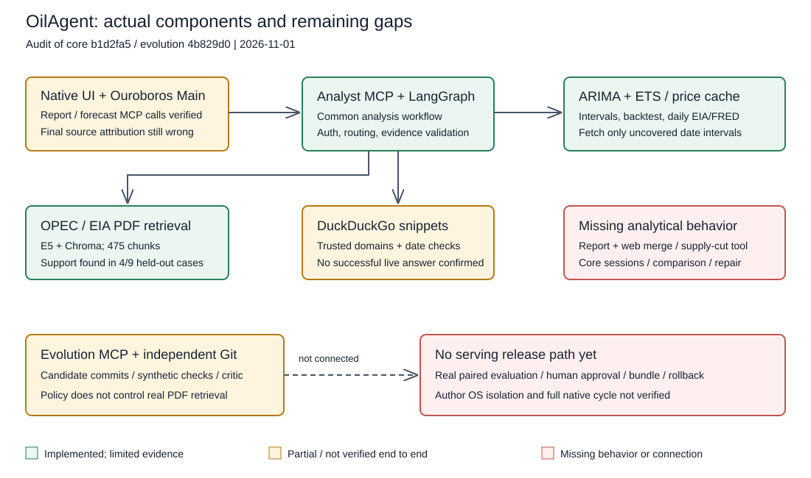

# Исторический аудит выполнения требований OilAgent

Этот аудит выполнен до последующей реализации. Текущий статус: [INTEGRATION_STATUS.md](INTEGRATION_STATUS.md).

1 ноября 2026. Проверены core `b1d2fa5` и evolution `4b829d0`.

**Вывод:** работающий интеграционный прототип, но требования DOCX и целевая архитектура закрыты не полностью. Главные пробелы задания — комбинированный report+web ответ, сценарный расчёт, пять демонстрационных диалогов, воспроизводимый запуск всей системы одной командой. Самоулучшение пока не изменяет реальный retrieval.

Источники требований: [оригинальный DOCX](Разработка_AI_агента_«Нефтегазовый_аналитик».docx) и [ARCHITECTURE.md](../ARCHITECTURE.md). Копия DOCX в docs побайтово совпадает с оригиналом в корне workspace. Архитектура содержит дополнительные предложения, а не только требования работодателя. Применён навык agent-architecture; аудит не меняет код или runtime settings.

## 1. Что проверено сейчас

- `pytest -q`: **103 passed**, 5 предупреждений сторонних библиотек.
- `ruff check src scripts tests` и `ruff format --check src scripts tests`: успешно.
- `scripts/eval_reports.py --split holdout` с отключённой сетью Hugging Face: **4/9** случаев с нужными фрагментами в retrieval и в контексте. Это не answer accuracy; результаты совпали с сохранённой оценкой.
- Две небольшие offline-пробы воспроизвели замену report evidence при web-fallback и статус `answered` после удаления части claims. Подменены внешние вызовы, не транспорт; это не live-проверка модели. [Доказательства](requirements-audit-evidence.json).
- `docker compose config --quiet`: успешно. `docker info`: daemon недоступен. Build/startup не проверены.
- В обоих локальных Git нет настроенного remote; URL опубликованного проекта не подтверждён.
- Live GigaChat, web, браузер и forecast повторно не запускались. Использованы ранее сохранённые evidence. **Новых LLM-вызовов: 0.**

Успех unit-тестов не доказывает качество аналитики, надёжность web, корректность финального пересказа UI или isolation. Исходные файлы и тесты просмотрены непосредственно; одних отметок в INTEGRATION_STATUS недостаточно.

## 2. Оригинальное задание DOCX

| Требование | Фактическое состояние | Остаток / проверка закрытия |
|---|---|---|
| §1, §3: использовать Ouroboros и LangChain/LangGraph | Реализовано: pinned Ouroboros, UI → Main → HTTP MCP → общий graph; есть live evidence | Не считать это завершённым циклом самоулучшения. Проверен адаптированный запуск с двумя in-process wrappers |
| §2.1: роль, отрасли, стиль, неопределённость | Роль подробно задана в instruction skill; core требует факты и цитаты, умеет воздерживаться | Нет оценки качества по Upstream/Midstream/Downstream, WTI/Urals, санкциям и ОПЕК+; текущие live-примеры узкие |
| §2.2: чанки, metadata, embeddings, vector DB, top-k | Реализовано: PyMuPDF, E5, Chroma, источник/дата/PDF page; локальные тесты и реальный корпус | Найденные фрагменты покрывают 4/9 отложенных вопросов; пять промахов открыты. Это ограничение качества, не отсутствие RAG |
| §2.3: web-поиск с фильтрацией СМИ | DDGS/DuckDuckGo, allowlist committed main evolution, даты и snippets; offline-тесты | Есть сохранённая выдача backend и ошибки adapter. Успешный свежий ответ через весь graph/UI не подтверждён |
| §2.3: текущие котировки | Не реализован надёжный live feed с instrument/type/timestamp/unit; система честно ограничивает ответ | Показать текущую цену из подходящего источника либо явно согласовать ограничение сдачи. Не подменять её последней EIA spot observation |
| §2.4: RAG как основной источник, web как дополнение | Частично: исторические вопросы идут в RAG, свежие — сразу в web; fallback есть | Настоящее объединение report+web отсутствует: web-node заменяет evidence. Нужен ответ с обеими группами источников, датами и без потери подтверждённых report facts |
| §2.4: маркировка происхождения фактов | Core формирует report/web ссылки программно | Native Main уже ошибочно назвал дневную историю ежемесячным отчётом. Нужна проверка финального UI-ответа, а не только core JSON |
| §2.5: исторические цены, ≥2 метода, интервалы, самостоятельный вызов | Реализовано: ARIMA + ETS, naive benchmark, 80% интервалы, rolling calibration/test, явный срез; live MCP/Giga evidence | Номинальные 80% не означают фактические 80%: ETS coverage ранее около 38–69%; naive немного лучше. Это раскрытое ограничение модели, не скрытая подмена |
| §2.5: оценка диапазона при сокращении добычи на N | Не реализовано: intent scenario возвращает tool_unavailable | Добавить сценарный tool с явными inputs/допущениями, единицами и диапазоном, а без inputs — уточнение; ARIMA без факторов этот сценарий не заменяет |
| §3: Python 3.10+, LangChain/LangGraph | Реализовано и проверено на Python 3.13/macOS ARM64 | Python 3.10/3.11 и Linux не проверены; минимальная версия самого проекта заявлена 3.11. Требование «3.10+» не означает обязательную поддержку всех версий |
| §3: LLM и объяснение выбора в README | GigaChat выбран и реально проверен; openai/local поддержаны кодом и offline-тестами | В README есть настройка, но нет чёткого обоснования выбора GigaChat. Живые openai/local и их structured output не проверены |
| §3: простой UI | Используется согласованный native UI Ouroboros; реальные браузерные report/forecast пробы | Частичная приёмка: источник forecast пересказан неверно; web/hybrid/out-of-scope/follow-up диалоги через UI не подтверждены |
| §3: Dockerfile и запуск одной командой | Есть Dockerfile и compose для двух MCP | UI/runtime/bootstrap/indexing не входят в compose; clean full-system startup одной командой отсутствует. Daemon недоступен, build/run не проверены |
| §3: конфигурация через .env, пример | Ключи, провайдеры, пути, top-k, timeout и output limit вынесены; есть .env.example | Размеры evidence, freshness 7 дней, некоторые параметры моделей и native limits заданы в коде. Нет единой полной конфигурации и подтверждённого переноса CA/путей в Docker |
| §4.1: GitHub/GitLab с чистой структурой | Два независимых соседних Git, исходники закоммичены | Публикация/URL не подтверждены; remote не настроен. Аудит не публикует проект |
| §4.2–4.3: исходники RAG/forecast, PDFs или загрузчик | Реализовано: исходники, manifest hashes, скрипт загрузки и индексирования; daily CSV в Git | Чистую установку на новой машине надо проверить отдельно; локальный подготовленный workspace этого не доказывает |
| §4.4: README, архитектура, запуск, запросы | Есть, примеры report/forecast и команды запуска присутствуют | Инструкции многошаговые; требуют проверки с нуля, синхронизации с фактической поставкой и объяснения выбора модели |
| §4.5: краткий отчёт 1–2 страницы с решениями/ограничениями | Есть старые ARCHITECTURE_SUMMARY.md/PDF, явно помеченные «до реализации» | Нужен итоговый отчёт о фактической реализации. Старый summary описывает Streamlit и ещё не исполненные компоненты; текущий аудит его не заменяет |
| §4.6: минимум 5 диалогов: report/web/hybrid/forecast/out-of-scope | Полного набора нет; есть отдельные evidence report/forecast и неуспех web | Добавить реальные диалоги и traces для всех пяти типов. Файла examples/demo_dialogues.md нет; вопросы и synthetic тесты не равны демонстрационным диалогам |

## 3. Дополнительные обещания ARCHITECTURE.md

| Раздел | Фактический пробел | Что уже есть / критерий закрытия |
|---|---|---|
| §4: сессионная память | Core принимает только question, не хранит session_id, последние 6 сообщений или структурированные сущности | История есть у native UI, skill просит разрешать follow-up. Это не реализация описанного core-контракта; проверить «а теперь на полгода?», неоднозначность и изоляцию сессий |
| §4: typed routing с сущностями и периодами | Route содержит intent/freshness/horizon/as_of/instrument/start/end, но нет metric/geography/publishers/reference_period или уточняемых сущностей | Нужен полный контракт либо честное сокращение документа; не менять текст ради скрытия обязательного поведения |
| §4, §6: достаточность и partial | Достаточность определяется в основном наличием принятых claims; нет покрытия частей запроса | Offline-проба: из 2 claims один удалён как invalid_citation, статус всё равно answered. Нужны проверка полноты и явные пробелы |
| §4: один repair и шаблонный fallback | Отдельного repair нет; существует только один web-fallback после insufficient_evidence | Проверить невалидный синтез → один repair → понятный partial, без циклов и придуманных данных |
| §5: сравнение показателей | Нет нормализации metric/geography/unit/period/vintage/actual-vs-forecast, защищённого вычисления разности | Есть interleave издателей и запрет LLM самостоятельно считать. Это помогает retrieval, но не реализует сравнение по контракту |
| §5: корпус/ingestion | Есть OPEC+EIA, IEA summary отсутствует; metadata reference_period/language/material_type/extraction_status неполны | IEA в архитектуре условен доступностью и не обязателен DOCX. Atomic index pointer реализован; полноценное извлечение/сравнение vintages не доказано |
| §6: typed claims | Есть text/source_id/quote и проверки подстроки/чисел | Нет типов fact/calculation/assumption, явных unit/period/value, формул/inputs/tool-run-id и проверки простой арифметики |
| §6, §10: смысловая достоверность | Exact quote и совпадение чисел не проверяют смысл, единицы и принадлежность факта вопросу | Нужна ручная claim→span→источник rubric на нескольких типах вопросов. Нулевые галлюцинации не обещаются |
| §8: реально исполняемая retrieval-policy | Policy читается и исполняется в synthetic checks, но ReportIndex.search её не загружает | До/после одной policy должны менять настоящий serving retrieval, на одном frozen корпусе и без подмены baseline |
| §8: paired evaluation и hidden holdout | Checks — три синтетические строки A1/A2/B1, не сравнение ответов на PDF-корпусе | Есть отдельная developer retrieval-оценка 4 development + 9 открытых вопросов. Она не подключена к Evolution runner; прежний holdout после просмотра стал regression-набором |
| §8: полный авторский цикл | Есть Git candidate/checks/critic backend, короткий model-authored probe и реальные HTTP MCP вызовы | Полный native author task ранее завершился 422; успешный полный proposal→checks→critic на реальном eval не подтверждён. Аналитические UI-вызовы этого не заменяют |
| §8: human release, bundle, manifest, rollback | Не реализованы; release_available=false, MCP намеренно не даёт release | Нужна отдельная операторская команда, точные версии/approval, атомарная активация и проверенный rollback. Без неё улучшение не поступает в serving |
| §8: fault recovery/idempotency jobs | Proposal/checks/verdict сохраняются, есть lock и повторное чтение | Нет испытаний crash между commit/ref и сохранением state, model timeout с неизвестным usage, release interruption. Review при недоступности можно повторить; это не строгая идемпотентность удалённого LLM-вызова |
| §9: OS isolation, trusted evaluator, secret boundaries | Разные процессы/токены есть, отдельного OS/container author sandbox нет | Native checkout/env очищены, CLI ограничивает tools; это не доказанная изоляция UI worker. Holdout не отделён от автора правами ОС |
| §9: budgets и остановка | Есть model timeout, disabled retries и native round/time settings; нет общего request budget/cost reservation | Лимиты LLM/tool calls, всего input tokens, wall-time graph, price config и гарантированный partial по исчерпанию не реализованы. Native cost settings без подтверждённого тарифа GigaChat не дают денежной гарантии |
| §9: logs/trace/replay/retention | Core возвращает request_id, usage, evidence; native пишет свои логи | Нет единого сохранённого trace/feedback, timings, release/model/corpus versions и retention/replay контракта core |
| §10–11: комплексная оценка | 103 unit/integration теста и узкие live evidence не равны 25–30 размеченным end-to-end случаям | Нужны report/web/hybrid/comparison/scenario/out-of-scope/injection/outage, финальная атрибуция UI, latency/usage и результаты по случаям |
| §12: понятный код около 3000 строк | 2575 строк src/scripts + 1188 тестов = 3763, обычное форматирование | Ориентир превышен на 763 строки. Пользователь сказал «желательно»; это не жёсткий отказ и не повод скрывать код или удалять важные проверки |

Изменения, которые **не следует считать недоделками**: native UI вместо Streamlit согласован; DDGS вместо Tavily допустим заданием; один фиксированный ARIMA order вместо перебора допустим; минимум 96 месяцев вместо ранней гипотезы 60 объясняется calibration/test; default top-k=4 и chunk=400 — параметры реализации. Запрет default output cap задан пользователем позже: `LLM_MAX_OUTPUT_TOKENS=None` сохраняется и тестируется. Табличные ограничения, отсутствие OCR и отсутствие торговли — заявленные границы, не скрытые функции.

## 4. Подтверждённые сильные части

- Два независимых Git и MCP, разные bearer credentials, protected policy schema, idempotent proposal и сохранение candidate main отдельно; auth и unsafe reject проверены.
- Реальный OPEC/EIA корпус: 154 PDF-страницы, 475 E5/Chroma фрагментов. Есть живой ответ EIA с проверенной PDF-цитатой.
- Реальные ARIMA/ETS, отдельные calibration и rolling test по h=1..6, naive comparison, 80% интервалы, контроль данных и отсутствие влияния будущих наблюдений в проверенном сценарии.
- MCP start_date/end_date; кеш скачивает только непокрытые интервалы, не перезаписывает сохранённые цены. Реальный HTTP MCP прогон с FRED/EIA подтвердил extended → hit без LLM. Сбои/пробелы покрыты offline-тестами.
- GigaChat live structured calls и самостоятельный выбор forecast подтверждены. OpenAI/local adapter есть, optional output limit сохраняется как None по умолчанию.
- Native UI проверен настоящим браузером на report/forecast, skill прошёл штатный review exact bytes. Известная ошибка финального пересказа сохранена, не объявлена успешной приёмкой.

Ссылки: [RAG](RAG.md), [retrieval eval](RETRIEVAL_EVAL.md), [web](WEB.md), [forecast](FORECAST.md), [кеш](history-cache-evidence.json), [native UI](UI.md), [интеграция](INTEGRATION_STATUS.md).

## 5. Приоритет закрытия

1. **Поведение из DOCX:** объединить report+web, реализовать scenario с явными inputs, исправить атрибуцию источника в финальном UI. Проверить успешный web-ответ и честное поведение при outage/current quote unavailable.
2. **Сдаваемый результат:** пять настоящих диалогов, итоговый короткий отчёт и README с обоснованием модели; clean installation и запуск всей поставки одной командой, затем Linux/Docker проверка и подтверждённый URL репозитория.
3. **Согласованное самоулучшение:** подключить policy к реальному retrieval, paired fixed eval с новым закрытым набором, затем полный author/check/critic и операторский release/rollback. До этого называть механизм кандидатов прототипом, а не доказанным улучшением аналитика.
4. **Остальные обещания архитектуры:** core memory/follow-up, сравнения, typed claims/repair, budgets, isolation, traces и оценка. При недельном сроке явно зафиксировать, какие остаются ограничениями; не выдавать их за требования DOCX или уже реализованные функции.

Для экономии квоты сначала deterministic/offline проверки, затем несколько выбранных live-запросов. Этот порядок — рекомендация аудита, не начало реализации и не разрешение публиковать/развёртывать проект.

## 6. Привязки к коду

- [web заменяет evidence](../src/analyst/graph.py:62), [scenario-заглушка](../src/analyst/graph.py:116), [свежие запросы пропускают RAG](../src/analyst/graph.py:178), [core без session contract](../src/analyst/graph.py:219).
- [контракты Route/Claim](../src/analyst/contracts.py:16), [верификация цитат/чисел](../src/analyst/evidence.py:22), [retrieval без Evolution policy](../src/analyst/rag.py:160).
- [синтетические checks](../src/analyst/evolution.py:192), [critic](../src/analyst/evolution.py:225), [реальная отдельная retrieval-оценка](../scripts/eval_reports.py:1).
- [MCP-контракты](../src/analyst/mcp_server.py:22), [cache](../src/analyst/prices.py:91), [forecast](../src/analyst/forecast.py:107), [compose](../compose.yaml:17).

