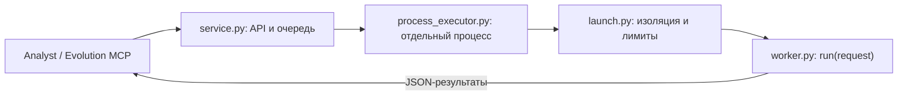

# Isolated Python execution queue

Исполняет Python-методы из `evolution`, включая кандидатов на самоулучшение,
отдельно от MCP-сервисов. Core передаёт исходник и JSON-входы, получает результаты
и проверяет их предметную корректность.



## Файлы

| Файл | Назначение |
|---|---|
| [service.py](service.py) | HTTP API, Bearer-аутентификация, ограничение очереди |
| [process_executor.py](process_executor.py) | Обмен с процессом, таймаут, контроль вывода и очистка |
| [launch.py](launch.py) | Chroot, смена UID/GID, resource limits и seccomp |
| [restrict.py](restrict.py) | Запрет сетевых и ряда опасных системных вызовов |
| [worker.py](worker.py) | Загрузка кода и последовательные вызовы `run(request)` |
| [Dockerfile.service](Dockerfile.service) | Образ Python с окружением исполнения |
| [requirements.lock](requirements.lock) | Фиксированные NumPy, SciPy, pandas и statsmodels |

## API

Оба endpoint требуют `Authorization: Bearer <RUNNER_TOKEN>`; токен — минимум 24 символа.
В контейнере используется порт 8013, host-порт по умолчанию — 8813.

- `GET /health` возвращает настроенный image digest, ABI и способ изоляции.
- `POST /execute` принимает `source`, список `inputs` и `timeout` в секундах.
  Ответ содержит `results` в порядке входов и `image`.
- При переполнении очереди возвращается `429`; ошибки задачи и лимитов — `422`.

Клиент core: [code_executor.py](../src/analyst/code_executor.py).
Вызывающий код не выбирает команду запуска, образ или mounts.

## Очередь и лимиты

Одновременно исполняется одна задача, ещё до четырёх могут ожидать.
Очередь реализована семафорами в памяти: FIFO и восстановление после рестарта не гарантируются.
Ответ синхронный. Ожидание занимает не более 10 секунд и учитывается в таймауте задачи.

| Ограничение | Значение |
|---|---:|
| Исходник | 64 000 байт |
| Входов в одной задаче | 1–64 |
| Сериализованный пакет для worker | 4 MiB |
| Суммарный stdout/stderr | 1 MiB |
| Wall timeout | 0.1–120 секунд |
| CPU дочернего процесса | 110 секунд |
| Адресное пространство | 1 GiB |

На задачу создаются процесс, временный каталог и отдельный UID. Код загружается один раз;
состояние между входами одной задачи может сохраняться. Следующий вход передаётся только
после результата предыдущего, поэтому будущие исторические префиксы не лежат заранее в stdin.
После завершения или ошибки родитель очищает процессы и временный каталог.

## Граница изоляции

Job работает внутри chroot с пониженными UID/GID и seccomp. Сеть заблокирована;
host mounts, Docker socket, MCP-токен и модельные секреты ему не передаются.
Изоляция использует общее ядро Linux и не исключает его уязвимости.

Runner контролирует ресурсы и JSON-протокол. ABI и предметные результаты проверяет core;
качество алгоритма оценивается отдельно.

## Запуск

Из `core/` с Docker и Compose:

```bash
./run.sh -d executor
./compose.sh logs --tail 50 executor
./compose.sh stop executor
```

Для работы всей системы используйте [основную инструкцию](../README.md).
